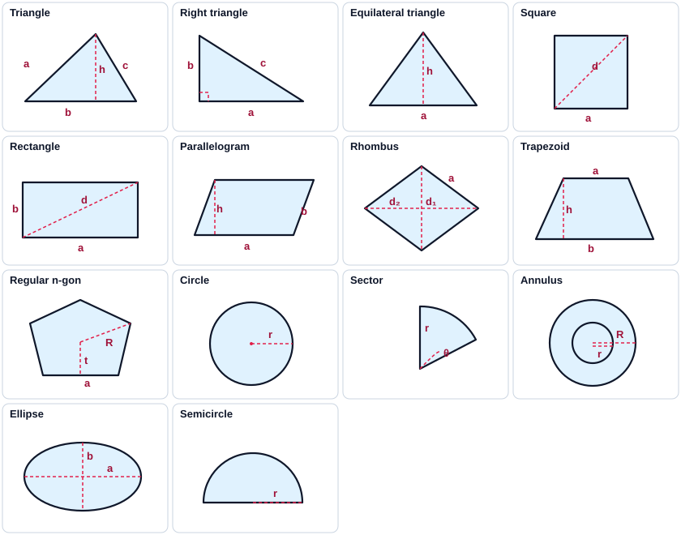
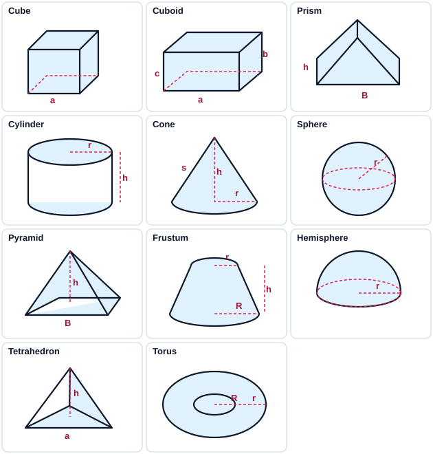

# Competitive Programming Reference Guide & Cheatsheet

**Team:** Hoffnang  
**Contestant:** Soyebuzaman Naim  
**Affiliation:** Southeast University (SEU CS Carnival 2026)  
**Standard:** C++17 / Fast I/O / 64-bit Int  

---

> [!IMPORTANT]
> **About this Notebook:**
> This document is designed for the **25-page competition notebook limit**. Every section includes:
> - 📌 **When to Use & Purpose**
> - ⏱️ **Time & Space Complexity**
> - ⚠️ **Key Traps & Constraints (e.g. 1LL overflow, 1-indexed vs 0-indexed)**
> - ⌨️ **VS Code Snippet Trigger Prefix** (matching your personal snippet library)

---

## Table of Contents
1. [Section 1: Contest Setup & Fast I/O](#section-1-contest-setup--fast-io)
2. [Section 2: C++ Basics & STL Essentials](#section-2-c-basics--stl-essentials)
3. [Section 3: Math, Number Theory & Bit Manipulation](#section-3-math-number-theory--bit-manipulation)
4. [Section 4: Graph Representations & Traversals](#section-4-graph-representations--traversals)
5. [Section 5: Shortest Paths & Negative Cycles](#section-5-shortest-paths--negative-cycles)
6. [Section 6: Tree Algorithms](#section-6-tree-algorithms)
7. [Section 7: Data Structures (DSU, Fenwick & Segment Tree)](#section-7-data-structures-dsu-fenwick--segment-tree)
8. [Section 8: String Algorithms (KMP & Trie)](#section-8-string-algorithms-kmp--trie)
9. [Section 9: Search Paradigms & Dynamic Programming](#section-9-search-paradigms--dynamic-programming)
10. [Section 10: Advanced Tools (Kruskal, Matrix Power & Geometry)](#section-10-advanced-tools-kruskal-matrix-power--geometry)
11. [Section 11: Graph algorithms](#section-11-graph-algorithms)
12. [Section 12: Offline queries and assignment](#section-12-offline-queries-and-assignment)
13. [Section 13: String algorithms](#section-13-string-algorithms)
14. [Section 14: Number theory](#section-14-number-theory)
15. [Section 15: Geometry algorithms](#section-15-geometry-algorithms)
16. [Section 16: Illustrated geometry formulas](#section-16-illustrated-geometry-formulas)
17. [Section 17: Math and contest formulas](#section-17-math-and-contest-formulas)

---

# Section 1: Contest Setup & Fast I/O

### 1.1 Fast I/O Contest Template
- **Trigger Prefix:** `cpp`
- **When to use:** Starter boilerplate for every problem.
- **Why:** `cin.tie(nullptr)` and `sync_with_stdio(false)` speed up I/O by ~10x. `#define int long long` eliminates 32-bit overflow errors on variable declarations.
```cpp
#include <bits/stdc++.h>
#include <cassert>
using namespace std;

#define int long long
#define endl '\n'
#define all(x) (x).begin(), (x).end()
#define rall(x) (x).rbegin(), (x).rend()
#define sz(x) (int)(x).size()

void fast_io() {
    ios::sync_with_stdio(false);
    cin.tie(nullptr);
}

signed main() {
    fast_io();

    int t;
    cin >> t;
    while (t--) {
        int n;
        cin >> n;
        vector<int> v(n);
        for (int &x : v)
            cin >> x;
    }
}
```

### 1.2 Custom Sort & Comparators
- **Trigger Prefix:** `custom_sort`
- **Time Complexity:** $O(N \log N)$
- **Includes:** Lambda comparator, free function, struct `operator<`, index sorting (argsort), and priority queue min-heap comparator.
```cpp
// 1. Lambda Comparator (Sort in-place without external function):
sort(v.begin(), v.end(), [](const auto& a, const auto& b) {
    if (a.first != b.first) return a.first < b.first; // Ascending by first
    return a.second > b.second;                       // Descending by second
});

// 2. Free Function Comparator:
bool comp(const pair<int, int>& a, const pair<int, int>& b) {
    return a.first < b.first;
}
sort(v.begin(), v.end(), comp);

// 3. Struct with Internal operator<:
struct Item {
    int val, id;
    bool operator<(const Item& o) const {
        if (val != o.val) return val < o.val;
        return id < o.id;
    }
};

// 4. Index Sorting (argsort - sort original indices by array values):
vector<int> p(n); iota(p.begin(), p.end(), 0);
sort(p.begin(), p.end(), [&](int i, int j) { return a[i] < a[j]; });

// 5. Comparator Struct for Priority Queue (Min-Heap by first):
struct ComparePQ {
    bool operator()(const pair<int, int>& a, const pair<int, int>& b) {
        return a.first > b.first; // Greater-than creates Min-Heap!
    }
};
priority_queue<pair<int, int>, vector<pair<int, int>>, ComparePQ> pq;
```

### 1.3 GCC Optimization Pragmas
- **When to use:** Hardware vectorization and loop unrolling for tight 1.0s time limits.
- **Check first:** The judge CPU must support AVX2; otherwise the program may fail at runtime.
```cpp
#pragma GCC optimize("O3,unroll-loops")
#pragma GCC target("avx2,bmi,bmi2,lzcnt,popcnt")
```

### 1.4 __int128 Fast I/O & Recursive Output
- **Trigger Prefix:** `int128`
- **Range:** $\approx [-3.4 \cdot 10^{38}, 3.4 \cdot 10^{38}]$
- **When to use:** Large multiplication products that exceed 64-bit `long long` before modulo.
```cpp
__int128 read128() {
    __int128 x = 0; int f = 1; char ch = getchar();
    while (ch < '0' || ch > '9') { if (ch == '-') f = -1; ch = getchar(); }
    while (ch >= '0' && ch <= '9') { x = x * 10 + ch - '0'; ch = getchar(); }
    return x * f;
}
void print128(__int128 x) {
    if (x < 0) { putchar('-'); x = -x; }
    if (x > 9) print128(x / 10);
    putchar(x % 10 + '0');
}
```

---

# Section 2: C++ Basics & STL Essentials

### 2.1 Primitive Types, Overflow Prevention & Float Comparisons
| Type | Bytes | Range | Key Rule |
|---|---|---|---|
| `int` | 4 | $\approx [-2 \cdot 10^9, 2 \cdot 10^9]$ | Default array indexing, sizes |
| `long long` | 8 | $\approx [-9 \cdot 10^{18}, 9 \cdot 10^{18}]$ | Required for sums, factorials, products |
| `double` | 8 | 15–17 decimal digits | Compare using `fabs(a - b) < 1e-9` |

```cpp
// 1. Preventing Integer Overflow
int a = 1e6, b = 1e6;
long long ans = 1LL * a * b; // 1LL forces 64-bit calculation!

// 2. Safe Floating Point Equality
const double EPS = 1e-9;
bool are_equal(double a, double b) { return fabs(a - b) < EPS; }

// 3. Fixed Precision Print
cout << fixed << setprecision(9) << ans << "\n";
```

### 2.2 C++ `<cmath>` Math Functions (exp, ln, root, sin, cos)
```cpp
const double PI = acos(-1.0); // Exact value of π: 3.141592653589793

// 1. Exponential (e^x) & Powers:
double e_to_x   = exp(x);              // e^x (for long double use expl(x))
double power    = pow(base, exp);      // base^exp (e.g. pow(2.0, 10.0) = 1024.0)

// 2. Natural Logarithm (ln) & Logarithms:
double natural  = log(x);              // ln(x) (natural log, base e)
double log_10   = log10(x);            // log10(x) (base 10)
double log_2    = log2(x);             // log2(x) (base 2)
double log_b    = log(x) / log(b);     // log_b(x) in arbitrary base b

// 3. Roots (Square, Cube & k-th Root):
double sq_root  = sqrt(x);             // √x (Square root: x >= 0)
double cb_root  = cbrt(x);             // ∛x (Cube root: works for negative inputs too!)
double kth_root = pow(x, 1.0 / k);     // k-th root of x: x^(1/k)

// 4. Trigonometry: sin, cos, tan (Input MUST be in RADIANS!):
double deg = 60.0;
double rad = deg * (PI / 180.0);       // Degrees to Radians!
double s   = sin(rad);                 // sin(60°) = √3 / 2 ≈ 0.866025
double c   = cos(rad);                 // cos(60°) = 0.5
double t   = tan(rad);                 // tan(60°) ≈ 1.73205

// 5. Inverse Trigonometry & Angles:
double angle_rad = atan2(y, x);        // Angle in radians [-π, π] from (x, y)
double angle_deg = angle_rad * 180.0 / PI; // Radians to Degrees!
double asin_val  = asin(s);            // arcsin (returns [-π/2, π/2])
double acos_val  = acos(c);            // arccos (returns [0, π])

// 6. Absolute & Hypotenuse:
double abs_val   = fabs(x);            // |x| for floating point (fabsl for long double)
double hyp       = hypot(x, y);        // √(x^2 + y^2) (safely prevents overflow)
```

### 2.3 Matrix I/O & 2D Grid Helpers
- **Time Complexity:** $O(N \times M)$
```cpp
// 1. Numeric Matrix N x M Input
int n, m; cin >> n >> m;
vector<vector<int>> a(n, vector<int>(m));
for (int i = 0; i < n; i++)
    for (int j = 0; j < m; j++)
        cin >> a[i][j];

// Matrix Output (space-separated, newline per row)
for (int i = 0; i < n; i++) {
    for (int j = 0; j < m; j++)
        cout << a[i][j] << (j == m - 1 ? "" : " ");
    cout << '\n';
}

// 2. Character Grid (Maze / Labyrinth Input)
vector<string> grid(n);
for (int i = 0; i < n; i++) cin >> grid[i];

// 3. Direction Arrays for Grid Navigation
int dx4[] = {-1, 1, 0, 0}, dy4[] = {0, 0, -1, 1}; // Up, Down, Left, Right (Rook / 4-step)
int dx8[] = {-1,-1,-1, 0, 0, 1, 1, 1};             // 8 directions (Queen / King / diagonals)
int dy8[] = {-1, 0, 1,-1, 1,-1, 0, 1};
// Knight moves (8 L-shaped jumps):
int knight_dx[] = {2, 2, 1, -1, 1, -1, -2, -2};
int knight_dy[] = {1, -1, 2, 2, -2, -2, -1, 1};
bool valid(int x, int y, int n, int m) { return x >= 0 && x < n && y >= 0 && y < m; }

// 4. Queen / Rook Move (Ray-casting / sliding across empty cells until '#'):
for (int i = 0; i < 4; i++) // use i < 4 for Rook, i < 8 for Queen (with dx8, dy8)
{
    int nx = x + dx[i];
    int ny = y + dy[i];
    while (nx >= 0 && ny >= 0 && nx < n && ny < m)
    {
        if (grid[nx][ny] == '#')
        {
            break;
        }
        if (dis[nx][ny] == -1)
        {
            dis[nx][ny] = dis[x][y] + 1;
            q.push({nx, ny});
        }
        nx += dx[i];
        ny += dy[i];
    }
}
```

### 2.3 All Type Converters & String Parsers
```cpp
// 1. Number <-> String
string s = to_string(12345LL);          // int / LL to string
int num = stoi("123");                   // string to int
long long lnum = stoll("1234567890123"); // string to long long
double d = stod("3.14159");              // string to double
long double ld = stold("3.1415926535");  // string to long double

// 2. Char <-> Digit & Alphabets
int digit = '7' - '0';                   // '7' -> 7
char ch = 7 + '0';                       // 7 -> '7'
int lower_idx = 'c' - 'a';               // 'c' -> 2 (0 to 25)
int upper_idx = 'C' - 'A';               // 'C' -> 2 (0 to 25)
char lower_c = tolower('A');             // 'A' -> 'a'
char upper_c = toupper('a');             // 'a' -> 'A'
// Entire string to lower/upper:
transform(s.begin(), s.end(), s.begin(), ::tolower);

// 3. Base Conversions (Binary, Hex, Octal)
int from_bin = stoi("10110", nullptr, 2);  // "10110" -> 22
int from_hex = stoi("1A", nullptr, 16);    // "1A" -> 26
int from_oct = stoi("75", nullptr, 8);     // "75" -> 61
string to_bin = bitset<32>(22).to_string(); // 22 -> "00...0010110"
to_bin = to_bin.substr(to_bin.find('1'));  // Trim leading zeros
stringstream ss; ss << hex << 255; string hex_str = ss.str(); // "ff"

// 4. String Tokenizer (split by space / delimiter)
stringstream ss2("apple banana cherry");
string word; while (ss2 >> word) { /* process each word */ }
stringstream ss3("1,2,3,4");
string item; while (getline(ss3, item, ',')) { int val = stoi(item); }
```

### 2.4 All STL Containers: Operations & Complexity
```cpp
// 1. VECTOR (Dynamic Array - O(1) push/pop_back, O(1) random access)
vector<int> v = {1, 2, 3};
v.push_back(4); v.pop_back(); v.front(); v.back(); v.size(); v.empty();
v.resize(10, 0); v.assign(5, -1); v.clear();
v.insert(v.begin() + 1, 99); v.erase(v.begin() + 1); // O(N)

// 2. PAIR & TUPLE
pair<int, string> p = {1, "ab"}; auto [id, name] = p; // C++17 structured binding
tuple<int, int, int> tp = {1, 2, 3}; auto [x, y, z] = tp; int f = get<0>(tp);

// 3. SET & MULTISET (Red-Black Tree - O(log N) operations, sorted)
set<int> s; s.insert(5); s.erase(5); bool has = s.count(5);
auto it_lb = s.lower_bound(x); // first element >= x
auto it_ub = s.upper_bound(x); // first element > x
multiset<int> ms; ms.insert(5); ms.insert(5);
ms.erase(ms.find(5)); // Erases ONLY ONE 5! (ms.erase(5) deletes ALL 5s)

// 4. MAP (Sorted key-value - O(log N)) & Frequency Counter
map<string, int> mp; mp["apple"] = 5; mp.count("apple"); mp.erase("apple");
for (auto &[key, val] : mp) { /* sorted by key */ }
// Frequency counter snippet:
map<int, int> freq; for (int x : v) freq[x]++;
int max_f = 0, most_frequent = -1;
for (auto &[val, count] : freq) {
    if (count > max_f) { max_f = count; most_frequent = val; }
}

// 5. PRIORITY_QUEUE (Heap - O(log N) push/pop, O(1) top)
priority_queue<int> max_pq; // Max heap by default
priority_queue<int, vector<int>, greater<int>> min_pq; // Min heap
max_pq.push(10); max_pq.top(); max_pq.pop();

// 6. DEQUE, STACK & QUEUE (O(1) push/pop)
deque<int> dq; dq.push_front(1); dq.push_back(2); dq.pop_front(); dq.pop_back();
stack<int> st; st.push(1); st.top(); st.pop();
queue<int> q; q.push(1); q.front(); q.pop();

// 7. BITSET (Fixed-size bit array - 64x faster bitwise ops)
bitset<64> bs(15); bs.set(2); bs.reset(2); bs.flip(); bool bit = bs.test(0);
int set_bits = bs.count(); unsigned long long val = bs.to_ullong();
```

### 2.5 All STL Algorithms: Quick Syntax & Uses
```cpp
// 1. Sorting & Bounds (v is vector<int>)
sort(all(v));                            // Ascending: O(N log N)
sort(rall(v));                           // Descending: O(N log N)
stable_sort(all(v), comp);               // Preserves relative order
auto it1 = lower_bound(all(v), x);       // First iterator with *it >= x
int idx1 = lower_bound(all(v), x) - v.begin(); // 0-based index of first >= x
auto it2 = upper_bound(all(v), x);       // First iterator with *it > x
bool found = binary_search(all(v), x);   // True if x exists (O(log N))

// 2. Element Operations & Deduplication
v.erase(unique(all(v)), v.end());        // Remove duplicates (sort first!)
reverse(all(v));                         // Invert order: O(N)
rotate(v.begin(), v.begin() + k, v.end()); // Left-rotates by k positions
int mn = *min_element(all(v));           // Minimum element: O(N)
int mx = *max_element(all(v));           // Maximum element: O(N)
int cnt = count(all(v), x);              // Count occurrences of x: O(N)
fill(all(v), 0);                         // Fill all with 0

// 3. Numeric & Prefix Sums (<numeric>)
int sum = accumulate(all(v), 0LL);       // Sum (use 0LL to prevent overflow!)
vector<int> pref(n);
partial_sum(all(v), pref.begin());       // Prefix sum array in-place: O(N)
iota(all(v), 0);                         // Fills with 0, 1, 2, ..., n-1

// 4. Permutations & Order Statistics
next_permutation(all(v));                // Next lexicographical order
prev_permutation(all(v));                // Previous order
// nth_element: Rearranges so element at index k is in its sorted position: O(N) avg
nth_element(v.begin(), v.begin() + k, v.end()); // v[k] is the k-th smallest!
```

### 2.6 Coordinate Compression
- **Trigger Prefix:** `compress`
- **Time Complexity:** $O(N \log N)$
- **When to use:** Mapping large arbitrary numbers (up to $10^9$) into compact 0-based ranks $[0, K-1]$ for BIT, SegTree, or frequency tables.
```cpp
// 1. In-place coordinate compression on vector 'a':
vector<int> vals = a;
sort(vals.begin(), vals.end());
vals.erase(unique(vals.begin(), vals.end()), vals.end());
for (int &x : a) {
    x = lower_bound(vals.begin(), vals.end(), x) - vals.begin(); // 0-based rank
}
// 2. Query original value: vals[compressed_id]
```

---

# Section 3: Math, Number Theory & Bit Manipulation

### 3.1 Greatest Common Divisor (GCD)
- **Trigger Prefix:** `gcdf`
- **Time Complexity:** $O(\log(\min(a, b)))$
```cpp
int gcd(int a, int b) {
    while (b) {
        a %= b;
        swap(a, b);
    }
    return a;
}
```

### 3.2 Least Common Multiple (LCM)
- **Trigger Prefix:** `lcmf`
- **Time Complexity:** $O(\log(\min(a, b)))$
- **Safety:** Divides before multiplying to prevent premature integer overflow.
```cpp
int lcm(int a, int b) {
    if (a == 0 || b == 0) return 0;
    return a / __gcd(a, b) * b;
}
```

### 3.3 Sieve of Eratosthenes (Prime Generation)
- **Trigger Prefix:** `gprime`
- **Time Complexity:** $O(N \log \log N)$
- **Usage:** Precomputes all primes up to $N \approx 10^7$ in milliseconds.
```cpp
// ---------- SIEVE OF ERATOSTHENES ----------
vector<int> primes;
vector<bool> is_prime;

void gprime(int n) {
    assert(n >= 0);
    is_prime.assign(n + 1, true);
    is_prime[0] = false;
    if (n >= 1) is_prime[1] = false;
    for (int i = 2; i * i <= n; i++) {
        if (is_prime[i]) {
            for (int j = i * i; j <= n; j += i)
                is_prime[j] = false;
        }
    }
    primes.clear();
    for (int i = 2; i <= n; i++) {
        if (is_prime[i]) primes.push_back(i);
    }
}
```

### 3.4 Linear Sieve & Fast Prime Factorization (SPF)
- **Trigger Prefix:** `spf`
- **Time Complexity:** $O(N)$ precomputation, $O(\log X)$ per factorization query.
- **When to use:** When you need to factorize multiple queries $Q \le 10^5$ with values up to $10^7$.
```cpp
const int MAXV = 1e7 + 5;
vector<int> spf(MAXV), primes_list;

void linear_sieve() {
    for (int i = 2; i < MAXV; ++i) {
        if (spf[i] == 0) { spf[i] = i; primes_list.push_back(i); }
        for (int p : primes_list) {
            if (p > spf[i] || i * p >= MAXV) break;
            spf[i * p] = p;
        }
    }
}

// Factorize any number x in O(log x):
vector<pair<int, int>> get_factors(int x) {
    vector<pair<int, int>> factors;
    while (x > 1) {
        int p = spf[x], count = 0;
        while (x % p == 0) { count++; x /= p; }
        factors.push_back({p, count});
    }
    return factors;
}
```

### 3.4 Binary Exponentiation with Modulo ($a^b \pmod m$)
- **Trigger Prefix:** `binExpoMod`
- **Time Complexity:** $O(\log b)$
```cpp
long long binpow(long long a, long long b, long long m) {
    assert(m > 0 && b >= 0);
    a %= m; if (a < 0) a += m;
    long long res = 1 % m;
    while (b > 0) {
        if (b & 1)
            res = (__int128)res * a % m;
        a = (__int128)a * a % m;
        b >>= 1;
    }
    return res;
}
```

### 3.5 Binary Exponentiation Standard ($a^b$)
- **Trigger Prefix:** `binExpo`
- **Time Complexity:** $O(\log b)$
```cpp
long long binpow(long long a, long long b) {
    long long res = 1;
    while (b > 0) {
        if (b & 1)
            res = res * a;
        a = a * a;
        b >>= 1;
    }
    return res;
}
```

### 3.6 Count Total Set Bits (1s) from 0 to N
- **Trigger Prefix:** `numofonef`
- **Time Complexity:** $O(\log N)$
- **Purpose:** Counts the total number of set bits ('1's) across all integers in $[0, n]$. The answer needs 128 bits for large 64-bit `n`; use `print128` from Section 1.4 to display it.
```cpp
__uint128_t numofone(unsigned long long n) {
    __uint128_t total = 0, count = (__uint128_t)n + 1;
    for (int bit = 0; bit < 64; ++bit) {
        __uint128_t half = (__uint128_t)1 << bit;
        __uint128_t period = half << 1;
        __uint128_t rem = count % period;
        total += (count / period) * half;
        if (rem > half) total += rem - half;
    }
    return total;
}
```

### 3.7 Extended GCD & Modular Inverse
- **Time Complexity:** $O(\log(\min(a, b)))$
```cpp
// Requires m > 1. An inverse exists only if gcd(a,m) = 1.
int ext_gcd(int a, int b, int &x, int &y) {
    if (b == 0) { x = 1; y = 0; return a; }
    int x1, y1, g = ext_gcd(b, a % b, x1, y1);
    x = y1; y = x1 - (a / b) * y1;
    return g;
}
int mod_inverse(int a, int m) {
    assert(m > 1);
    a %= m; if (a < 0) a += m;
    int x, y, g = ext_gcd(a, m, x, y);
    assert(g == 1);
    x %= m; if (x < 0) x += m;
    return x;
}
```

### 3.8 Numerically Stable Quadratic Equation Solver
- **Trigger Prefix:** `quadf`
- **Time Complexity:** $O(1)$
- **Algorithm:** Citardauq formula $q = -0.5 \cdot (b + \text{copysign}(\sqrt{D}, b))$ avoids catastrophic floating-point cancellation when $b \approx \sqrt{b^2 - 4ac}$.
- **Handles:** Degenerate linear cases ($a = 0$), repeated roots ($D = 0$), and no real roots ($D < 0$).
```cpp
using ld = long double;
const ld EPS = 1e-12;

void solve_quadratic(ld a, ld b, ld c) {
    cout << fixed << setprecision(12);
    // Linear equation: bx + c = 0
    if (fabsl(a) < EPS) {
        if (fabsl(b) < EPS) cout << "No solution\n";
        else cout << -c / b << '\n';
        return;
    }

    ld d = b * b - 4 * a * c;

    // No real roots
    if (d < -EPS) {
        cout << "No real roots\n";
        return;
    }

    // One repeated root
    if (fabsl(d) <= EPS) {
        cout << -b / (2 * a) << '\n';
        return;
    }

    // Two real roots with Citardauq numerical stability
    ld sq = sqrtl(d);
    ld q = -0.5L * (b + copysignl(sq, b));

    ld x1 = q / a;
    ld x2 = c / q;

    if (x1 > x2) swap(x1, x2);

    cout << x1 << '\n' << x2 << '\n';
}
```

### 3.9 Basis Conversion (Arbitrary Base 2 to 16)
- **Time Complexity:** $O(\log_b N)$
- **Capability:** Bidirectional conversion between base-$b$ string and `unsigned long long` for any base $b \le 16$.
```cpp
#include <algorithm>
#include <string>
#include <vector>

const std::string DIGITS = "0123456789ABCDEF";

// Convert base-b string to unsigned long long
unsigned long long int basis_string_to_number(std::string &s, int b) {
    unsigned long long int result = 0ULL;
    for (char d : s) {
        result = b * result + (std::find(DIGITS.begin(), DIGITS.end(), d) - DIGITS.begin());
    }
    return result;
}

// Convert unsigned long long to base-b string
std::string number_to_basis_string(unsigned long long int n, int b) {
    std::vector<char> ds;
    do {
        ds.push_back(DIGITS[n % b]);
        n = n / b;
    } while (n != 0);
    return std::string(ds.rbegin(), ds.rend());
}
```

### 3.10 All Binary Operations & Bit Manipulation Hacks
- **Time Complexity:** $O(1)$ per operation
```cpp
// 1. GCC Builtin Functions (Append 'll' for 64-bit integers: e.g. __builtin_popcountll)
int ones = __builtin_popcountll(x);   // Count set bits (number of 1s)
int clz  = __builtin_clzll(x);        // Count leading zeros (undefined if x=0!)
int ctz  = __builtin_ctzll(x);        // Count trailing zeros (lowest set bit index)
int par  = __builtin_parityll(x);     // Parity: 1 if odd number of 1s, 0 if even
int msb  = 63 - __builtin_clzll(x);   // Index of highest set bit (= floor(log2(x)))

// 2. Essential Bit Hacks
bool is_set   = (n >> k) & 1;          // Check if k-th bit is 1 (0-indexed)
n |= (1LL << k);                      // Set k-th bit to 1
n &= ~(1LL << k);                     // Clear k-th bit to 0
n ^= (1LL << k);                      // Toggle k-th bit (flip 0 <-> 1)
bool is_pow2  = n > 0 && !(n & (n - 1)); // True if n is a power of 2
int lsb       = n & (-n);             // Isolates lowest set bit: e.g. 12 (1100) -> 4 (0100)
n &= (n - 1);                         // Clears the lowest set bit

// 3. Iterate All Submasks of Mask m (in strictly descending order)
for (int s = m; s > 0; s = (s - 1) & m) {
    // s is a non-empty submask of m. Total operations across all masks: O(3^N)
}

// 4. Iterate All Masks of Size N
for (int mask = 0; mask < (1 << n); ++mask) { /* O(2^N) */ }
```

### 3.11 Complete Modulo Sheet & $O(1)$ nCr Combinatorics
- **Primes:** Standard CP moduli are $10^9 + 7$ or $998244353$ (NTT friendly).
- **Conditions:** Fermat inverse needs a prime modulus and a nonzero residue; factorial-based `nCr` needs `n < MOD`.
```cpp
const int MOD = 1e9 + 7; // or 998244353

// 1. Safe Operations (handles negatives & prevents overflow)
long long norm(long long x) { x %= MOD; return x < 0 ? x + MOD : x; }
long long add(long long a, long long b) { return (norm(a) + norm(b)) % MOD; }
long long sub(long long a, long long b) { return (norm(a) - norm(b) + MOD) % MOD; }
long long mul(long long a, long long b) { return norm(a) * norm(b) % MOD; }

// 2. Fast Exponentiation: (base^exp) % MOD
long long power(long long base, long long exp) {
    long long res = 1; base = norm(base);
    while (exp > 0) {
        if (exp % 2 == 1) res = (res * base) % MOD;
        base = (base * base) % MOD;
        exp /= 2;
    }
    return res;
}

// 3. Modular Inverse via Fermat's Little Theorem (MOD must be prime) & Division
long long modInverse(long long n) { assert(norm(n) != 0); return power(n, MOD - 2); }
long long divi(long long a, long long b) { return mul(a, modInverse(b)); }

// 4. O(N) Precomputation for O(1) nCr Modulo P (N up to 10^6):
const int MAXN = 1000005;
long long fact[MAXN], invFact[MAXN];
int prepared_n = -1;
void precompute_nCr(int n = MAXN - 1) {
    assert(0 <= n && n < MOD && n < MAXN);
    fact[0] = invFact[0] = 1;
    for (int i = 1; i <= n; i++) fact[i] = mul(fact[i - 1], i);
    invFact[n] = modInverse(fact[n]);
    for (int i = n - 1; i >= 1; i--) invFact[i] = mul(invFact[i + 1], i + 1);
    prepared_n = n;
}
long long nCr_mod(int n, int r) {
    if (r < 0 || r > n) return 0;
    assert(0 <= n && n <= prepared_n);
    return mul(fact[n], mul(invFact[r], invFact[n - r]));
}
```

---

# Section 4: Graph Representations & Traversals

### 4.1 Adjacency List Input
- **Trigger Prefix:** `adjlist`
- **Usage:** Input for general weighted graph with $V$ vertices and $E$ edges.
```cpp
int V, E;
cin >> V >> E;

// Adjacency list: adj[u] = vector of {v, weight}
vector<vector<pair<int, int>>> adj(V);

for (int i = 0; i < E; ++i) {
    int u, v, w;
    cin >> u >> v >> w;
    adj[u].push_back({v, w}); // for directed graph
    // adj[v].push_back({u, w}); // for undirected graph
}
```

### 4.2 Edge List Input
- **Trigger Prefix:** `adjmat`
```cpp
int V, E;
cin >> V >> E;

// Edge list: each edge is a vector of 3 integers {u, v, weight}
vector<vector<int>> edges;

for (int i = 0; i < E; ++i) {
    int u, v, w;
    cin >> u >> v >> w;
    edges.push_back({u, v, w});
}
```

### 4.3 DFS Traversal with Graph Input
- **Trigger Prefix:** `dfs`
- **Time Complexity:** $O(V + E)$
```cpp
void dfs(int node, const vector<int> adj[], vector<bool>& visited) {
    visited[node] = true;
    for (int neighbor : adj[node]) {
        if (!visited[neighbor]) {
            dfs(neighbor, adj, visited);
        }
    }
}

signed main() {
    int n, m; cin >> n >> m;
    vector<int> adj[n + 1];
    vector<bool> visited(n + 1, false);

    for (int i = 0; i < m; ++i) {
        int u, v; cin >> u >> v;
        adj[u].push_back(v);
        adj[v].push_back(u); // Remove if directed
    }

    for (int i = 1; i <= n; ++i) {
        if (!visited[i]) dfs(i, adj, visited);
    }
    return 0;
}
```

### 4.4 DFS Function Only
- **Trigger Prefix:** `dfsfunc`
```cpp
void dfs(int node, const vector<int> adj[], vector<bool>& visited) {
    visited[node] = true;
    for (int neighbor : adj[node]) {
        if (!visited[neighbor]) {
            dfs(neighbor, adj, visited);
        }
    }
}
```

### 4.5 BFS Traversal with Graph Input
- **Trigger Prefix:** `bfs`
- **Time Complexity:** $O(V + E)$
```cpp
void bfs(int start, const vector<int> adj[], vector<bool>& visited) {
    queue<int> q;
    q.push(start);
    visited[start] = true;

    while (!q.empty()) {
        int node = q.front(); q.pop();
        for (int neighbor : adj[node]) {
            if (!visited[neighbor]) {
                visited[neighbor] = true;
                q.push(neighbor);
            }
        }
    }
}

signed main() {
    int n, m; cin >> n >> m;
    vector<int> adj[n + 1];
    vector<bool> visited(n + 1, false);

    for (int i = 0; i < m; ++i) {
        int u, v; cin >> u >> v;
        adj[u].push_back(v);
        adj[v].push_back(u); // Remove if directed
    }

    for (int i = 1; i <= n; ++i) {
        if (!visited[i]) bfs(i, adj, visited);
    }
}
```

### 4.6 BFS Function Only
- **Trigger Prefix:** `bfsfunc`
```cpp
void bfs(int start, const vector<int> adj[], vector<bool>& visited) {
    queue<int> q;
    q.push(start);
    visited[start] = true;

    while (!q.empty()) {
        int node = q.front(); q.pop();
        for (int neighbor : adj[node]) {
            if (!visited[neighbor]) {
                visited[neighbor] = true;
                q.push(neighbor);
            }
        }
    }
}
```

### 4.7 2D Grid BFS (Maze Shortest Path & Queen/Knight Moves)
- **Trigger Prefix:** `bfs_grid`
- **Time Complexity:** $O(N \times M)$
```cpp
int main() {
    int n, m; cin >> n >> m;
    vector<string> grid(n);
    for (int i = 0; i < n; i++) cin >> grid[i];

    vector<vector<int>> dis(n, vector<int>(m, -1));
    queue<pair<int, int>> q;
    int sx, sy, ex, ey;

    // Find Source (S) and Destination (E)
    for (int i = 0; i < n; i++) {
        for (int j = 0; j < m; j++) {
            if (grid[i][j] == 'S') { sx = i; sy = j; }
            if (grid[i][j] == 'E') { ex = i; ey = j; }
        }
    }

    q.push({sx, sy});
    dis[sx][sy] = 0;
    int dx[] = {-1, 1, 0, 0}, dy[] = {0, 0, -1, 1}; // 4 directions
    // int dx[] = {2, 2, 1, -1, 1, -1, -2, -2}, dy[] = {1, -1, 2, 2, -2, -2, -1, 1}; // Knight

    while (!q.empty()) {
        auto [x, y] = q.front(); q.pop();
        if (x == ex && y == ey) {
            cout << "Shortest distance = " << dis[x][y] << '\n';
            return 0;
        }

        // 1. Single-Step Move (4 directions):
        for (int i = 0; i < 4; i++) {
            int nx = x + dx[i], ny = y + dy[i];
            if (nx >= 0 && nx < n && ny >= 0 && ny < m &&
                grid[nx][ny] != '#' && dis[nx][ny] == -1) {
                q.push({nx, ny});
                dis[nx][ny] = dis[x][y] + 1;
            }
        }

        // 2. Queen / Rook Ray-Casting Move (sliding until obstacle '#'):
        /*
        for (int i = 0; i < 4; i++) { // i < 4 for Rook, i < 8 for Queen
            int nx = x + dx[i], ny = y + dy[i];
            while (nx >= 0 && ny >= 0 && nx < n && ny < m) {
                if (grid[nx][ny] == '#') break;
                if (dis[nx][ny] == -1) {
                    dis[nx][ny] = dis[x][y] + 1;
                    q.push({nx, ny});
                }
                nx += dx[i]; ny += dy[i];
            }
        }
        */
    }
    cout << "Destination not reachable\n";
}
```

### 4.8 BFS Traversal with Path Printing & Predecessors
- **Trigger Prefix:** `bfs_path`
- **Time Complexity:** $O(V + E)$
```cpp
void bfs(vector<vector<int>>& adj_list, int src, int n, int destination) {
    vector<string> color(n, "white");
    vector<int> dis(n, INT_MAX);
    vector<int> pred(n, -1);

    queue<int> q;
    q.push(src);
    color[src] = "grey";
    dis[src] = 0;

    while (!q.empty()) {
        int par = q.front(); q.pop();
        color[par] = "black";
        for (auto child : adj_list[par]) {
            if (color[child] == "white") {
                q.push(child);
                color[child] = "grey";
                dis[child] = dis[par] + 1;
                pred[child] = par;
            }
        }
    }

    int node = destination;
    vector<int> path;
    while (node != -1) {
        path.push_back(node);
        node = pred[node];
    }
    reverse(path.begin(), path.end());
    for (int i = 0; i < path.size(); i++) cout << path[i] << " ";
    cout << '\n';

    if (dis[destination] == INT_MAX) cout << "disconnected\n";
    else cout << "distance-> " << dis[destination] << '\n';
}
```

### 4.9 Topological Sort (Kahn's In-Degree BFS)
- **Time Complexity:** $O(V + E)$
- **Condition:** Graph must be a Directed Acyclic Graph (DAG).
```cpp
vector<int> topo_sort(int n, const vector<vector<int>> &adj) {
    vector<int> in_deg(n, 0), order;
    for (int u = 0; u < n; ++u)
        for (int v : adj[u]) in_deg[v]++;
    queue<int> q;
    for (int i = 0; i < n; ++i) if (in_deg[i] == 0) q.push(i);
    while (!q.empty()) {
        int u = q.front(); q.pop();
        order.push_back(u);
        for (int v : adj[u])
            if (--in_deg[v] == 0) q.push(v);
    }
    return (order.size() == n) ? order : vector<int>(); // empty if cycle
}
```

### 4.10 Bipartite Graph Check & 2-Coloring (BFS)
- **Trigger Prefix:** `bipartite`
- **Time Complexity:** $O(V + E)$
- **When to use:** Check if graph has no odd-length cycles and can be partitioned into two independent sets.
```cpp
bool is_bipartite(int n, const vector<vector<int>> &adj, vector<int> &color) {
    color.assign(n + 1, -1);
    for (int start = 1; start <= n; ++start) {
        if (color[start] != -1) continue;
        queue<int> q; q.push(start); color[start] = 0;
        while (!q.empty()) {
            int u = q.front(); q.pop();
            for (int v : adj[u]) {
                if (color[v] == -1) {
                    color[v] = color[u] ^ 1; q.push(v);
                } else if (color[v] == color[u]) return false; // Odd cycle!
            }
        }
    }
    return true;
}
```

---

# Section 5: Shortest Paths & Negative Cycles

### 5.1 Dijkstra's Algorithm (Priority Queue & Path Print)
- **Trigger Prefix:** `dijkstra`
- **Time Complexity:** $O((V + E) \log V)$
- **Constraint:** All edge weights must be non-negative ($w \ge 0$).
- **Graph:** This example adds both directions. Remove the reverse edge for a directed graph. Shortest paths must stay below `inf`.
```cpp
int n, m; cin >> n >> m;
vector<vector<pair<int, long long>>> adj(n + 1);
for (int i = 0; i < m; i++) {
    int u, v; long long w; cin >> u >> v >> w;
    adj[u].emplace_back(v, w);
    adj[v].emplace_back(u, w);
}
int s = 1; const long long inf = LLONG_MAX / 4;
vector<long long> dis(n + 1, inf);
vector<int> parent(n + 1, -1);
dis[s] = 0;
priority_queue<pair<long long, int>, vector<pair<long long, int>>, greater<pair<long long, int>>> pq;
pq.emplace(0, s);
while (!pq.empty()) {
    auto [dv, v] = pq.top(); pq.pop();
    if (dv > dis[v]) continue;
    for (auto &edge : adj[v]) {
        int to = edge.first; long long d = edge.second;
        assert(d >= 0);
        if (d <= inf - dis[v] && dis[v] + d < dis[to]) {
            dis[to] = dis[v] + d;
            parent[to] = v;
            pq.emplace(dis[to], to);
        }
    }
}
if (dis[n] == inf) {
    cout << -1 << endl;
} else {
    vector<int> path;
    for (int i = n; i != -1; i = parent[i]) path.push_back(i);
    reverse(path.begin(), path.end());
    for (int node : path) cout << node << " ";
    cout << endl;
}
```

### 5.2 Dijkstra's Algorithm (Set-Based)
- **Trigger Prefix:** `dijkstraSet`
- **Time Complexity:** $O((V + E) \log V)$
- **Requires:** Nonnegative edge weights. Unreachable vertices keep `INF`; path sums must stay below `INF`.
```cpp
const long long INF = LLONG_MAX / 4;
vector<vector<pair<int, long long>>> adj;

void dijkstra(int s, vector<long long>& d, vector<int>& p) {
    int n = adj.size();
    d.assign(n, INF);
    p.assign(n, -1);
    d[s] = 0;
    set<pair<long long, int>> q;
    q.insert({0, s});
    while (!q.empty()) {
        int v = q.begin()->second;
        q.erase(q.begin());

        for (auto [to, len] : adj[v]) {
            assert(len >= 0);
            if (len <= INF - d[v] && d[v] + len < d[to]) {
                q.erase({d[to], to});
                d[to] = d[v] + len;
                p[to] = v;
                q.insert({d[to], to});
            }
        }
    }
}
```

### 5.3 0-1 BFS (Deque Shortest Path)
- **Trigger Prefix:** `bfs01`
- **Time Complexity:** $O(V + E)$
- **When to use:** Shortest paths on graphs where edge weights are strictly $0$ or $1$. Much faster than Dijkstra ($O(V+E)$ vs $O(E \log V)$).
```cpp
vector<int> zero_one_bfs(int start, int n, const vector<vector<pair<int, int>>> &adj) {
    vector<int> dist(n + 1, 1e9);
    deque<int> dq;
    dist[start] = 0;
    dq.push_back(start);
    while (!dq.empty()) {
        int u = dq.front(); dq.pop_front();
        for (auto &[v, w] : adj[u]) {
            if (dist[u] + w < dist[v]) {
                dist[v] = dist[u] + w;
                if (w == 0) dq.push_front(v); // Push 0-cost edge to front!
                else dq.push_back(v);        // Push 1-cost edge to back!
            }
        }
    }
    return dist;
}
```

### 5.4 Bellman-Ford Algorithm
- **Trigger Prefix:** `bellman_ford`
- **Time Complexity:** $O(V \cdot E)$
- **Capability:** Supports negative edge weights; detects negative cycle reachable from $S$.
- **Returns:** `{has_reachable_negative_cycle, distances}`; unreachable vertices keep `INF`. Path sums must fit in the chosen distance range.
```cpp
const long long BF_INF = LLONG_MAX / 4;
pair<bool, vector<long long>> bellman_ford(
    int n, const vector<tuple<int,int,long long>>& edges, int S) {
    vector<long long> dis(n, BF_INF);
    dis[S] = 0;
    for (int i = 0; i < n - 1; i++) {
        bool updated = false;
        for (auto [u,v,w] : edges) {
            if (dis[u] != BF_INF && dis[u] + w < dis[v]) {
                dis[v] = dis[u] + w;
                updated = true;
            }
        }
        if (!updated) break;
    }
    for (auto [u,v,w] : edges)
        if (dis[u] != BF_INF && dis[u] + w < dis[v]) return {true, dis};
    return {false, dis};
}
```

### 5.5 Negative Cycle Detection & Path Reconstruction
- **Trigger Prefix:** `negcyclef`
- **Time Complexity:** $O(V \cdot E)$
- **Key Detail:** Steps back $N$ times (`x = p[x]`) to guarantee the pointer enters the cycle before printing.
```cpp
int n, m; cin >> n >> m;
vector<vector<int>> edges;
for (int i = 0; i < m; ++i) {
    int u, v, w; cin >> u >> v >> w;
    edges.push_back({u, v, w});
}
vector<int> dist(n + 1, 0), p(n + 1, -1);
int x;
for (int i = 0; i < n; i++) {
    x = -1;
    for (auto &edge : edges) {
        int u = edge[0], v = edge[1], w = edge[2];
        if (dist[u] + w < dist[v]) {
            dist[v] = dist[u] + w;
            p[v] = u;
            x = v;
        }
    }
}
if (x == -1) {
    cout << "NO" << endl;
    return 0;
}
for (int i = 0; i < n; i++) x = p[x];
cout << "YES" << endl;
vector<int> path;
int cur = x; path.push_back(cur);
while (true) {
    cur = p[cur];
    path.push_back(cur);
    if (cur == x) break;
}
reverse(all(path));
for (int node : path) cout << node << " ";
cout << endl;
```

### 5.6 Floyd-Warshall (All-Pairs Shortest Path)
- **Time Complexity:** $O(V^3)$ (Suitable for $N \le 500$)
```cpp
for (int k = 0; k < n; ++k)
    for (int i = 0; i < n; ++i)
        for (int j = 0; j < n; ++j)
            if (dist[i][k] < INF && dist[k][j] < INF)
                dist[i][j] = min(dist[i][j], dist[i][k] + dist[k][j]);
```

---

# Section 6: Tree Algorithms

### 6.1 Tree Diameter via Double BFS
- **Trigger Prefix:** `treeDiameter`
- **Time Complexity:** $O(V + E)$
- **Theorem:** An arbitrary BFS from node 1 finds node $u$ (one endpoint of diameter). A second BFS from $u$ finds node $v$ and the exact diameter length.
- **Indexing:** The complete example expects a connected tree with vertices numbered 1 through `n`.
```cpp
pair<int, int> bfs_farthest(int start, const vector<vector<int>>& adj, int n) {
    vector<int> dist(n + 1, -1);
    queue<int> q;
    q.push(start);
    dist[start] = 0;
    int farthest_node = start;

    while (!q.empty()) {
        int node = q.front(); q.pop();
        for (int neighbor : adj[node]) {
            if (dist[neighbor] == -1) {
                dist[neighbor] = dist[node] + 1;
                q.push(neighbor);
                if (dist[neighbor] > dist[farthest_node])
                    farthest_node = neighbor;
            }
        }
    }
    return {farthest_node, dist[farthest_node]};
}

signed main() {
    ios::sync_with_stdio(false); cin.tie(nullptr);
    int n; cin >> n;
    vector<vector<int>> adj(n + 1);
    for (int i = 0; i < n - 1; ++i) {
        int u, v; cin >> u >> v;
        adj[u].push_back(v); adj[v].push_back(u);
    }
    int far1 = bfs_farthest(1, adj, n).first;
    int diameter = bfs_farthest(far1, adj, n).second;
    cout << diameter << '\n';
}
```

### 6.2 Lowest Common Ancestor (Binary Lifting)
- **Trigger Prefix:** `lca`
- **Time Complexity:** $O(N \log N)$ precomputation, $O(\log N)$ query.
- **Includes:** LCA, k-th ancestor, and $O(\log N)$ exact tree path distance.
```cpp
const int MAXN = 2e5 + 5, LOGN = 20;
vector<int> tree_adj[MAXN];
int up[MAXN][LOGN], depth[MAXN];

void build_lca(int root) { // iterative: safe for a long chain
    vector<int> q = {root};
    for (int i = 0; i < LOGN; ++i) up[root][i] = -1;
    depth[root] = 0;
    for (size_t head = 0; head < q.size(); ++head) {
        int u = q[head];
        for (int v : tree_adj[u]) if (v != up[u][0]) {
            depth[v] = depth[u] + 1;
            up[v][0] = u;
            for (int i = 1; i < LOGN; ++i)
                up[v][i] = up[v][i-1] == -1 ? -1 : up[up[v][i-1]][i-1];
            q.push_back(v);
        }
    }
}

int get_lca(int u, int v) {
    if (depth[u] < depth[v]) swap(u, v);
    int diff = depth[u] - depth[v];
    for (int i = 0; i < LOGN; ++i)
        if ((diff >> i) & 1) u = up[u][i];
    if (u == v) return u;
    for (int i = LOGN - 1; i >= 0; --i) {
        if (up[u][i] != up[v][i]) { u = up[u][i]; v = up[v][i]; }
    }
    return up[u][0];
}

int tree_dist(int u, int v) {
    return depth[u] + depth[v] - 2 * depth[get_lca(u, v)];
}
```

---

# Section 7: Data Structures (DSU, Fenwick & Segment Tree)

### 7.1 Disjoint Set Union (Union by Size)
- **Trigger Prefix:** `dsu-size`
- **Time Complexity:** $O(\alpha(N)) \approx O(1)$ per operation
```cpp
// Union by size
class DisjointSet {
    vector<int> rank, parent, size;

public:
    DisjointSet(int n) {
        rank.resize(n + 1, 0);
        parent.resize(n + 1);
        size.resize(n + 1, 1);
        for (int i = 0; i <= n; i++) parent[i] = i;
    }

    int findUPar(int node) {
        if (node == parent[node]) return node;
        return parent[node] = findUPar(parent[node]);
    }

    void unionBySize(int u, int v) {
        int ulpU = findUPar(u), ulpV = findUPar(v);
        if (ulpU == ulpV) return;
        if (size[ulpU] < size[ulpV]) {
            parent[ulpU] = ulpV;
            size[ulpV] += size[ulpU];
        } else {
            parent[ulpV] = ulpU;
            size[ulpU] += size[ulpV];
        }
    }

    bool connected(int u, int v) {
        return findUPar(u) == findUPar(v);
    }
};
```

### 7.2 Fenwick Tree (BIT: Sum & Range Average)
- **Time Complexity:** $O(\log N)$ query and update, $O(N)$ memory.
- **Average Property:** Average is easily computed as `sum / (r - l + 1)`.
```cpp
struct Fenwick {
    int n; vector<long long> bit;
    Fenwick(int n) : n(n), bit(n + 1, 0) {}

    void add(int idx, long long val) { // 1-based; idx=0 would never advance
        assert(1 <= idx && idx <= n);
        for (; idx <= n; idx += idx & -idx) bit[idx] += val;
    }

    long long query(int idx) { // prefix sum [1, idx]; query(0)=0
        assert(0 <= idx && idx <= n);
        long long sum = 0;
        for (; idx > 0; idx -= idx & -idx) sum += bit[idx];
        return sum;
    }

    long long range_query(int l, int r) { assert(1 <= l && l <= r && r <= n); return query(r) - query(l - 1); }

    // Range Average (Integer & Decimal): average = sum / number_of_elements
    long long avg(int l, int r) { // Integer average
        return range_query(l, r) / (r - l + 1);
    }
    double avg_d(int l, int r) { // Decimal average
        return (double)range_query(l, r) / (r - l + 1);
    }
};
```

### 7.3 Iterative Segment Tree (Range Sum & Point Update)
- **Time Complexity:** $O(\log N)$ query and update
- **Advantage:** Non-recursive, zero recursion overhead, memory size $2N$.
```cpp
struct SegTree {
    int n; vector<int> t;
    SegTree(int n) : n(n), t(2 * n, 0) {}

    void update(int p, int val) {
        for (t[p += n] = val; p > 1; p >>= 1)
            t[p >> 1] = t[p] + t[p ^ 1];
    }

    int query(int l, int r) { // sum on interval [l, r] (0-indexed)
        int res = 0;
        for (l += n, r += n + 1; l < r; l >>= 1, r >>= 1) {
            if (l & 1) res += t[l++];
            if (r & 1) res += t[--r];
        }
        return res;
    }
};
```

### 7.4 Segment Tree for MIN & MAX (Minimal Adaptations)
- **Segment Tree for MIN:**
  1. Initialize with infinity: `SegTree(int n) : n(n), t(2 * n, numeric_limits<int>::max()) {}`
  2. Update change: `t[p >> 1] = min(t[p], t[p ^ 1]);`
  3. Query:
  ```cpp
  int query(int l, int r) {
      int res = numeric_limits<int>::max();
      for (l += n, r += n + 1; l < r; l >>= 1, r >>= 1) {
          if (l & 1) res = min(res, t[l++]);
          if (r & 1) res = min(res, t[--r]);
      }
      return res;
  }
  ```
- **Segment Tree for MAX:**
  1. Initialize: `SegTree(int n) : n(n), t(2 * n, numeric_limits<int>::lowest()) {}`
  2. Update change: `t[p >> 1] = max(t[p], t[p ^ 1]);`
  3. Query:
  ```cpp
  int query(int l, int r) {
      int res = numeric_limits<int>::lowest();
      for (l += n, r += n + 1; l < r; l >>= 1, r >>= 1) {
          if (l & 1) res = max(res, t[l++]);
          if (r & 1) res = max(res, t[--r]);
      }
      return res;
  }
  ```

### 7.5 KACTL Iterative Segment Tree (Associative f, [b, e))
- **Time Complexity:** $O(\log N)$
- **Interval:** Semi-open $[b, e)$.
```cpp
struct Tree {
    typedef int T;
    static constexpr T unit = numeric_limits<T>::lowest();
    T f(T a, T b) { return max(a, b); } // any associative fn
    vector<T> s; int n;
    Tree(int n = 0, T def = unit) : s(2 * n, def), n(n) {}
    void update(int pos, T val) {
        for (s[pos += n] = val; pos /= 2;)
            s[pos] = f(s[pos * 2], s[pos * 2 + 1]);
    }
    T query(int b, int e) { // query [b, e)
        T ra = unit, rb = unit;
        for (b += n, e += n; b < e; b /= 2, e /= 2) {
            if (b % 2) ra = f(ra, s[b++]);
            if (e % 2) rb = f(s[--e], rb);
        }
        return f(ra, rb);
    }
};
```

### 7.6 Lazy Segment Tree (Range Add, Set & Max)
- **Time Complexity:** $O(\log N)$ per operation; $O(N)$ memory. Build from the initial array. All ranges are $[L,R)$.
```cpp
struct LazySegTree {
    struct Node { long long mx=0, add=0, set=0; bool has_set=false; };
    int n; vector<Node> t;
    explicit LazySegTree(const vector<long long>& a) : n(a.size()), t(4 * max(1, n)) {
        if (n) build(1, 0, n, a);
    }
    void build(int p, int l, int r, const vector<long long>& a) {
        if (r-l==1) { t[p].mx=a[l]; return; }
        int m=(l+r)/2; build(2*p,l,m,a); build(2*p+1,m,r,a);
        t[p].mx=max(t[2*p].mx,t[2*p+1].mx);
    }
    void apply_set(int p, long long x) {
        t[p].mx=x; t[p].set=x; t[p].add=0; t[p].has_set=true;
    }
    void apply_add(int p, long long x) {
        t[p].mx+=x;
        if (t[p].has_set) t[p].set+=x;
        else t[p].add+=x;
    }
    void push(int p) {
        if (t[p].has_set) {
            apply_set(2*p,t[p].set); apply_set(2*p+1,t[p].set);
            t[p].has_set=false;
        }
        if (t[p].add) {
            apply_add(2*p,t[p].add); apply_add(2*p+1,t[p].add);
            t[p].add=0;
        }
    }
    void update(int p,int l,int r,int L,int R,long long x,bool assign) {
        if (R<=l || r<=L) return;
        if (L<=l && r<=R) { if (assign) apply_set(p,x); else apply_add(p,x); return; }
        push(p); int m=(l+r)/2;
        update(2*p,l,m,L,R,x,assign); update(2*p+1,m,r,L,R,x,assign);
        t[p].mx=max(t[2*p].mx,t[2*p+1].mx);
    }
    long long get(int p,int l,int r,int L,int R) {
        if (R<=l || r<=L) return LLONG_MIN;
        if (L<=l && r<=R) return t[p].mx;
        push(p); int m=(l+r)/2;
        return max(get(2*p,l,m,L,R),get(2*p+1,m,r,L,R));
    }
    void set(int L,int R,long long x) { assert(0<=L && L<=R && R<=n); if(L<R) update(1,0,n,L,R,x,true); }
    void add(int L,int R,long long x) { assert(0<=L && L<=R && R<=n); if(L<R) update(1,0,n,L,R,x,false); }
    long long query(int L,int R) { assert(0<=L && L<R && R<=n); return get(1,0,n,L,R); }
};
```

### 7.7 Sparse Table (O(1) Static RMQ / GCD)
- **Trigger Prefix:** `sparsetable`
- **Time Complexity:** $O(N \log N)$ build, $O(1)$ query.
- **When to use:** Static arrays with no updates where idempotent queries (minimum, maximum, GCD) are performed in $O(1)$.
```cpp
template<typename T>
struct SparseTable {
    int n, K;
    vector<vector<T>> st;
    SparseTable(const vector<T>& a) {
        n = a.size(); K = __lg(n) + 1;
        st.assign(K, vector<T>(n));
        st[0] = a;
        for (int j = 1; j < K; ++j)
            for (int i = 0; i + (1 << j) <= n; ++i)
                st[j][i] = min(st[j - 1][i], st[j - 1][i + (1 << (j - 1))]);
    }
    T query(int L, int R) { // 0-based inclusive range [L, R]
        int j = __lg(R - L + 1);
        return min(st[j][L], st[j][R - (1 << j) + 1]);
    }
};
```

---

# Section 8: String Algorithms (KMP & Trie)

### 8.1 Knuth-Morris-Pratt (KMP) Pattern Search
- **Trigger Prefix:** `kmp`
- **Time Complexity:** $O(N + M)$
- **Returns:** All 0-based match start positions of `pat` in `text`.
```cpp
// Preprocess pattern to build LPS array
vector<int> buildLPS(const string &pat) {
    int m = pat.size(), len = 0;
    vector<int> lps(m, 0);
    for (int i = 1; i < m;) {
        if (pat[i] == pat[len]) {
            len++; lps[i] = len; i++;
        } else {
            if (len != 0) len = lps[len - 1];
            else { lps[i] = 0; i++; }
        }
    }
    return lps;
}

// KMP search: find occurrences of pattern in text
vector<int> KMPsearch(const string &text, const string &pat) {
    int n = text.size(), m = pat.size();
    if (m == 0) { vector<int> all(n + 1); iota(all.begin(), all.end(), 0); return all; }
    vector<int> lps = buildLPS(pat), positions;
    int i = 0, j = 0;
    while (i < n) {
        if (text[i] == pat[j]) {
            i++; j++;
            if (j == m) {
                positions.push_back(i - j); // match at i - m
                j = lps[j - 1];
            }
        } else {
            if (j != 0) j = lps[j - 1];
            else i++;
        }
    }
    return positions;
}
```

### 8.2 Trie (Prefix Tree) & Binary Trie (Max XOR Pair)
- **Trigger Prefix:** `trie`
- **Time Complexity:** $O(|S|)$ for string insertions/queries, $O(30 \cdot N)$ for max XOR pair.
- **Includes:** Character trie for words/prefixes and 32-bit binary trie for XOR optimization.
```cpp
// 1. Character Trie (Prefix search & frequency)
struct TrieNode { int next[26] = {}, pass = 0, end = 0; };
vector<TrieNode> trie(1);

void insert_str(const string &s) {
    int cur = 0;
    for (char ch : s) {
        int c = ch - 'a';
        if (!trie[cur].next[c]) {
            trie[cur].next[c] = trie.size();
            trie.emplace_back();
        }
        cur = trie[cur].next[c];
        trie[cur].pass++;
    }
    trie[cur].end++;
}

// 2. Binary Trie (Maximum XOR of two numbers in array)
struct BitTrie { int nxt[2] = {}; };
vector<BitTrie> bt(1);

void insert_num(int x) {
    int cur = 0;
    for (int i = 30; i >= 0; --i) {
        int b = (x >> i) & 1;
        if (!bt[cur].nxt[b]) { bt[cur].nxt[b] = bt.size(); bt.emplace_back(); }
        cur = bt[cur].nxt[b];
    }
}

int query_max_xor(int x) {
    int cur = 0, max_xor = 0;
    for (int i = 30; i >= 0; --i) {
        int b = (x >> i) & 1, opp = b ^ 1;
        if (bt[cur].nxt[opp]) { max_xor |= (1 << i); cur = bt[cur].nxt[opp]; }
        else cur = bt[cur].nxt[b];
    }
    return max_xor;
}
```

---

# Section 9: Search Paradigms & Dynamic Programming

### 9.1 Bitmasking Complete Search (Apple Division)
- **Trigger Prefix:** `bitMaskingAppleDivision`
- **Time Complexity:** $O(2^N \cdot N)$ (Feasible for $N \le 20$)
```cpp
int n; cin >> n;
vector<int> v(n);
for (int &x : v) cin >> x;

int ans = LLONG_MAX;
for (int i = 0; i < (1 << n); i++) {
    int a = 0, b = 0;
    for (int pos = 0; pos < n; pos++) {
        if (i & (1 << pos)) a += v[pos];
        else b += v[pos];
    }
    ans = min(ans, llabs(a - b));
}
cout << ans << endl;
```

### 9.2 Two Pointers & Sliding Window Patterns
- **Time Complexity:** $O(N)$
- **Precondition:** The sliding-window sum pattern requires nonnegative array values and `K >= 0`; use `long long` for sums.
```cpp
// 1. OPPOSITE DIRECTION (Target Sum on Sorted Array: O(N))
int l = 0, r = n - 1;
while (l < r) {
    int sum = a[l] + a[r];
    if (sum == target) { /* found pair (l, r) */ break; }
    else if (sum < target) l++;
    else r--;
}

// 2. SAME DIRECTION (sum <= K, a[i] >= 0 and K >= 0)
int left = 0, max_len = 0;
long long cur_sum = 0;
for (int right = 0; right < n; ++right) {
    cur_sum += a[right];
    while (cur_sum > K && left <= right) cur_sum -= a[left++];
    max_len = max(max_len, right - left + 1);
}

// 3. MERGING TWO SORTED LISTS (Original twoPointer snippet: O(N + M))
vector<int> a(n), b(m), c;
for (int &x : a) cin >> x;
for (int &x : b) cin >> x;
int i = 0, j = 0;
while (i < n || j < m) {
    while ((i < n) && (j >= m || (a[i] <= b[j]))) { c.push_back(a[i]); i++; }
    while ((j < m) && (i >= n || b[j] <= a[i])) { c.push_back(b[j]); j++; }
}
```

### 9.3 Binary Search on Answer (Integer & Real Monotonic Predicates)
- **Trigger Prefix:** `bs_ans`
- **Time Complexity:** $O(\log(\text{Range}) \times \text{Check})$
- **When to use:** When the answer is monotonic: `check(mid)` is true for all $x \le \text{ans}$ (or $x \ge \text{ans}$).
```cpp
// 1. Integer Range: Find minimum valid mid satisfying check(mid)
long long lo = 1, hi = 1e18, best = -1;
while (lo <= hi) {
    long long mid = lo + (hi - lo) / 2;
    if (check(mid)) {
        best = mid;
        hi = mid - 1; // Try to find smaller valid threshold
    } else {
        lo = mid + 1; // Must go larger
    }
}

// 2. Real range: double stops at machine precision, not 10^-30.
double l = 0.0, r = 1e9;
for (int iter = 0; iter < 100; ++iter) {
    double mid = (l + r) / 2.0;
    if (mid == l || mid == r) break;
    if (check_double(mid)) r = mid; // or l = mid depending on monotonicity
    else l = mid;
}
```

### 9.4 0-1 Knapsack & Unbounded Knapsack
- **Time Complexity:** $O(N \cdot W)$ with $O(W)$ space.
```cpp
// 0-1 Knapsack (each item at most once)
int knapsack_01(int W, const vector<int>& wt, const vector<int>& val, int n) {
    vector<int> dp(W + 1, 0);
    for (int i = 0; i < n; i++)
        for (int w = W; w >= wt[i]; w--) // BACKWARDS
            dp[w] = max(dp[w], dp[w - wt[i]] + val[i]);
    return dp[W];
}

// Unbounded Knapsack: change inner loop to: for (int w = wt[i]; w <= W; w++)
```

### 9.5 Longest Increasing Subsequence ($O(N \log N)$)
```cpp
int lis(const vector<int>& a) {
    vector<int> tails;
    for (int x : a) {
        auto it = lower_bound(tails.begin(), tails.end(), x);
        if (it == tails.end()) tails.push_back(x);
        else *it = x;
    }
    return tails.size();
}
```

### 9.6 Kadane's Algorithm (Max Subarray Sum with Range Indices)
- **Time Complexity:** $O(N)$
```cpp
long long max_sum = -1e18, cur = 0;
int best_l = 0, best_r = 0, start = 0;
for (int i = 0; i < n; i++) {
    cur += a[i];
    if (cur > max_sum) { max_sum = cur; best_l = start; best_r = i; }
    if (cur < 0) { cur = 0; start = i + 1; }
} // Max contiguous subarray sum is on range [best_l, best_r]
```

### 9.7 Longest Common Subsequence (LCS with Path Reconstruction)
- **Time Complexity:** $O(N \cdot M)$
```cpp
string get_lcs(const string &s, const string &t) {
    int n = s.size(), m = t.size();
    vector<vector<int>> dp(n + 1, vector<int>(m + 1, 0));
    for (int i = 1; i <= n; i++)
        for (int j = 1; j <= m; j++)
            dp[i][j] = (s[i - 1] == t[j - 1]) ? 1 + dp[i - 1][j - 1] : max(dp[i - 1][j], dp[i][j - 1]);
    string res = ""; int i = n, j = m;
    while (i > 0 && j > 0) {
        if (s[i - 1] == t[j - 1]) { res += s[i - 1]; i--; j--; }
        else if (dp[i - 1][j] > dp[i][j - 1]) i--;
        else j--;
    }
    reverse(res.begin(), res.end());
    return res; // Length is dp[n][m]
}
```

### 9.8 Coin Change (Min Coins & Total Combinations)
- **Time Complexity:** $O(N \cdot X)$
```cpp
// 1. Min coins to make target amount X:
vector<int> dp(X + 1, 1e9); dp[0] = 0;
for (int i = 1; i <= X; i++)
    for (int c : coins) if (i >= c) dp[i] = min(dp[i], dp[i - c] + 1);
int min_coins = (dp[X] >= 1e9 ? -1 : dp[X]);

// 2. Number of distinct combinations (coins outer loop):
vector<int> ways(X + 1, 0); ways[0] = 1;
for (int c : coins)
    for (int i = c; i <= X; i++) ways[i] = (ways[i] + ways[i - c]) % MOD;
```

### 9.9 Edit Distance (Levenshtein Distance)
- **Time Complexity:** $O(N \cdot M)$
```cpp
int edit_distance(const string &s1, const string &s2) {
    int n = s1.size(), m = s2.size();
    vector<vector<int>> dp(n + 1, vector<int>(m + 1));
    for (int i = 0; i <= n; i++) dp[i][0] = i;
    for (int j = 0; j <= m; j++) dp[0][j] = j;
    for (int i = 1; i <= n; i++) {
        for (int j = 1; j <= m; j++) {
            if (s1[i - 1] == s2[j - 1]) dp[i][j] = dp[i - 1][j - 1];
            else dp[i][j] = 1 + min({dp[i - 1][j], dp[i][j - 1], dp[i - 1][j - 1]});
        }
    }
    return dp[n][m];
}
```

---

# Section 10: Advanced Tools (Kruskal, Matrix Power & Geometry)

### 10.1 Kruskal's Minimum Spanning Tree (MST)
- **Trigger Prefix:** `kruskal`, `mst`
- **Time Complexity:** $O(E \log E)$
```cpp
#include <bits/stdc++.h>
using namespace std;

class DisjointSet
{
    vector<int> parent, size;

public:
    DisjointSet(int n)
    {
        parent.resize(n + 1);
        size.resize(n + 1, 1);

        for(int i = 0; i <= n; i++)
        {
            parent[i] = i;
        }
    }

    int findUPar(int node)
    {
        if(node == parent[node])
        {
            return node;
        }

        return parent[node] = findUPar(parent[node]);
    }

    void unionBySize(int u, int v)
    {
        int ulpU = findUPar(u);
        int ulpV = findUPar(v);

        if(ulpU == ulpV)
        {
            return;
        }

        if(size[ulpU] < size[ulpV])
        {
            parent[ulpU] = ulpV;
            size[ulpV] += size[ulpU];
        }
        else
        {
            parent[ulpV] = ulpU;
            size[ulpU] += size[ulpV];
        }
    }

    bool connected(int u, int v)
    {
        return findUPar(u) == findUPar(v);
    }
};

struct Edge
{
    int u, v, w;

    bool operator<(const Edge& o) const
    {
        return w < o.w;
    }
};

optional<long long> kruskal(int n, vector<Edge>& edges)
{
    sort(edges.begin(), edges.end());

    DisjointSet dsu(n);

    long long cost = 0;
    int count = 0;

    if(n <= 1) return 0;

    for(auto& e : edges)
    {
        if(!dsu.connected(e.u, e.v))
        {
            dsu.unionBySize(e.u, e.v);
            cost += e.w;
            count++;

            if(count == n - 1)
            {
                return cost;
            }
        }
    }

    return nullopt; // disconnected; a valid MST may have cost -1
}

int main()
{
    ios::sync_with_stdio(false);
    cin.tie(nullptr);

    int n, m;
    cin >> n >> m;

    vector<Edge> edges(m);

    for(int i = 0; i < m; i++)
    {
        cin >> edges[i].u >> edges[i].v >> edges[i].w;
    }

    auto ans = kruskal(n, edges);

    if(!ans)
    {
        cout << "MST does not exist" << '\n';
    }
    else
    {
        cout << "Minimum cost = " << *ans << '\n';
    }

    return 0;
}
```

### 10.2 Matrix Exponentiation ($O(K^3 \log N)$)
```cpp
template<typename T = long long>
struct Matrix {
    int n; vector<vector<T>> a;
    Matrix(int n) : n(n), a(n, vector<T>(n, 0)) {}
    static Matrix eye(int n) {
        Matrix res(n); for (int i = 0; i < n; i++) res.a[i][i] = 1;
        return res;
    }
    Matrix operator*(const Matrix& o) const {
        Matrix res(n);
        for (int i = 0; i < n; i++)
            for (int k = 0; k < n; k++)
                for (int j = 0; j < n; j++)
                    res.a[i][j] = (res.a[i][j] + a[i][k] * o.a[k][j]) % 1000000007;
        return res;
    }
    static Matrix power(Matrix m, long long p) {
        Matrix res = Matrix::eye(m.n);
        while (p) {
            if (p & 1) res = res * m;
            m = m * m; p >>= 1;
        }
        return res;
    }
};
```

### 10.3 Shoelace Formula (Polygon Area)
- **Time Complexity:** $O(N)$
```cpp
struct Point { double x, y; };

double polygon_area(const vector<Point>& p) {
    double area = 0.0;
    int n = p.size();
    for (int i = 0; i < n; ++i) {
        int j = (i + 1) % n;
        area += p[i].x * p[j].y - p[j].x * p[i].y;
    }
    return fabs(area) / 2.0;
}
```

### 10.4 2D Point, Vectors, Dot & Cross Products
```cpp
struct Pt {
    double x, y;
    Pt(double x = 0, double y = 0) : x(x), y(y) {}
    Pt operator+(Pt p) const { return {x + p.x, y + p.y}; }
    Pt operator-(Pt p) const { return {x - p.x, y - p.y}; }
    Pt operator*(double d) const { return {x * d, y * d}; }
    Pt operator/(double d) const { return {x / d, y / d}; }
    double dot(Pt p) const { return x * p.x + y * p.y; }       // |a||b|cos(θ)
    double cross(Pt p) const { return x * p.y - y * p.x; }     // |a||b|sin(θ)
    double dist2() const { return x * x + y * y; }
    double dist() const { return sqrt(dist2()); }
    double angle() const { return atan2(y, x); }
};
// Orientation: > 0 = CCW (left turn), < 0 = CW (right turn), == 0 = Collinear
double ccw(Pt a, Pt b, Pt c) { return (b - a).cross(c - a); }
```

### 10.5 Lines, Segments & Triangles Equations
```cpp
// 1. Distance from point P to line AB:
double dist_to_line(Pt p, Pt a, Pt b) {
    return fabs((b - a).cross(p - a)) / (b - a).dist();
}

// 2. Line Intersection (A1*x + B1*y = C1 and A2*x + B2*y = C2 via Cramer):
bool line_inter(double a1, double b1, double c1, double a2, double b2, double c2, Pt &out) {
    double d = a1 * b2 - a2 * b1;
    if (fabs(d) < 1e-9) return false; // Parallel or collinear
    out.x = (c1 * b2 - c2 * b1) / d;
    out.y = (a1 * c2 - a2 * c1) / d;
    return true;
}

// 3. Triangle Formulas: sides a, b, c
// Heron's Area: s = (a + b + c) / 2
double heron(double a, double b, double c) {
    double s = (a + b + c) / 2.0;
    return sqrt(max(0.0, s * (s - a) * (s - b) * (s - c)));
}
// Inradius: r = Area / s | Circumradius: R = (a * b * c) / (4 * Area)
double inradius(double a, double b, double c) { return heron(a, b, c) / ((a + b + c) / 2.0); }
double circumradius(double a, double b, double c) { return (a * b * c) / (4.0 * heron(a, b, c)); }
```

### 10.6 Pick's Theorem, Centroid & 3D Solids
```cpp
// 1. Pick's Theorem: Area = I + B/2 - 1  =>  I = Area - B/2 + 1
// B = boundary lattice points = sum(gcd(|x2-x1|, |y2-y1|)) for all polygon edges
// I = strictly interior lattice points

// 2. Polygon Centroid (Center of Mass):
Pt polygon_centroid(const vector<Pt>& p) {
    Pt c(0, 0); double A = 0; int n = p.size();
    for (int i = 0; i < n; i++) {
        int j = (i + 1) % n; double cross = p[i].cross(p[j]);
        A += cross; c = c + (p[i] + p[j]) * cross;
    }
    return c / (3.0 * A);
}

// 3. Circles & 3D Solid Geometry Equations:
// Circle:   Area = π * r^2, Circumference = 2 * π * r
// Sphere:   Volume = (4/3) * π * r^3, Surface Area = 4 * π * r^2
// Cylinder: Volume = π * r^2 * h, Surface Area = 2 * π * r * (r + h)
// Cone:     Volume = (1/3) * π * r^2 * h, Slant height s = sqrt(r^2 + h^2)
```

### 10.7 Math Series, Logarithms & Algebra Cheatsheet
```cpp
// 1. Summation Formulas:
// Sum of 1..N:           N * (N + 1) / 2
// Sum of i^2 for i=1..N: N * (N + 1) * (2N + 1) / 6
// Sum of i^3 for i=1..N: (N * (N + 1) / 2)^2
// Geometric Progression: a + a*r + ... + a*r^(n-1) = a * (r^n - 1) / (r - 1)

// 2. Logarithm & Exponent Rules:
// log_b(a) = ln(a) / ln(b) = log10(a) / log10(b)
// log(a * b) = log(a) + log(b), log(a / b) = log(a) - log(b), log(a^k) = k * log(a)

// 3. Number of Digits of N in Base B: floor(log_B(N)) + 1
// 4. Stirling's Approximation: n! ≈ sqrt(2 * π * n) * (n / e)^n
```

<!-- EXTENDED_REFERENCE_START -->

---

# Extended contest reference

All code below is C++17 and 0-indexed. The tested source is `reference/algorithms.hpp`; each block belongs inside `namespace cpref` or can have `cpref::` removed. Dependencies are stated above the blocks.

## Section 11: Graph algorithms

### 11.1 Strongly connected components
- **How to use:** Build the directed graph with zero-indexed vertices, then call the SCC routine once. It assigns a component ID to every vertex; vertices share an ID exactly when each can reach the other. Contracting components produces a DAG for later processing, in O(V+E) time.
- **Source:** KACT graph pp. 12–13
```cpp
#ifdef int
#pragma push_macro("int")
#undef int
#define CPREF_POP_INT
#endif
struct SCC {
  int n;
  std::vector<std::vector<int>> g, rg;
  explicit SCC(int n) : n(n), g(n), rg(n) {}
  void add_edge(int u, int v) {
    g[u].push_back(v);
    rg[v].push_back(u);
  }

  // Kosaraju: component IDs are in topological order (source first).
  std::vector<int> components() const {
    std::vector<char> seen(n);
    std::vector<int> order, comp(n, -1);
    for (int root = 0; root < n; ++root)
      if (!seen[root]) {
        std::vector<std::pair<int, int>> st{{root, 0}};
        seen[root] = 1;
        while (!st.empty()) {
          auto &[u, i] = st.back();
          if (i == (int)g[u].size()) {
            order.push_back(u);
            st.pop_back();
          } else {
            int v = g[u][i++];
            if (!seen[v])
              seen[v] = 1, st.push_back({v, 0});
          }
        }
      }
    int id = 0;
    for (int i = n - 1; i >= 0; --i) {
      int root = order[i];
      if (comp[root] != -1)
        continue;
      std::vector<int> st{root};
      comp[root] = id;
      while (!st.empty()) {
        int u = st.back();
        st.pop_back();
        for (int v : rg[u])
          if (comp[v] == -1)
            comp[v] = id, st.push_back(v);
      }
      ++id;
    }
    return comp;
  }
};
#ifdef CPREF_POP_INT
#pragma pop_macro("int")
#undef CPREF_POP_INT
#endif
```

### 11.2 2-SAT
- **How to use:** Create a Boolean variable for each choice and add every clause as (x=value OR y=value). The solver builds implications and uses SCC; it returns an assignment when satisfiable, otherwise reports failure. Call the SCC-based routine from this section with the required namespace or copy its dependency.
- **Source:** KACT graph p. 13
```cpp
#ifdef int
#pragma push_macro("int")
#undef int
#define CPREF_POP_INT
#endif
// Depends on SCC above. Literal (variable x, truth value val) is 2*x +
// val.
struct TwoSAT {
  int n;
  SCC scc;
  explicit TwoSAT(int n) : n(n), scc(2 * n) {}
  int lit(int x, bool val) const { return 2 * x + int(val); }
  void implication(int a, int b) { scc.add_edge(a, b); }
  void add_or(int x, bool xv, int y, bool yv) {
    int a = lit(x, xv), b = lit(y, yv);
    implication(a ^ 1, b);
    implication(b ^ 1, a);
  }
  std::optional<std::vector<bool>> solve() const {
    auto c = scc.components();
    std::vector<bool> ans(n);
    for (int x = 0; x < n; ++x) {
      if (c[2 * x] == c[2 * x + 1])
        return std::nullopt;
      ans[x] = c[2 * x + 1] > c[2 * x];
    }
    return ans;
  }
};
#ifdef CPREF_POP_INT
#pragma pop_macro("int")
#undef CPREF_POP_INT
#endif
```

### 11.3 Bridges in an undirected multigraph
- **How to use:** Give each undirected edge one unique ID and add both adjacency directions with that ID. The DFS low-link test returns edges whose removal increases the component count. Parallel edges are handled by IDs; recursion can exhaust the stack on a very deep graph.
- **Source:** KACT graph p. 12
```cpp
#ifdef int
#pragma push_macro("int")
#undef int
#define CPREF_POP_INT
#endif
// Undirected multigraph: edge IDs prevent a parallel edge becoming a
// false bridge.
struct Bridges {
  int n, timer = 0;
  std::vector<std::vector<std::pair<int, int>>> g;
  std::vector<int> tin, low, bridge_ids;
  explicit Bridges(int n) : n(n), g(n), tin(n, -1), low(n) {}
  void add_edge(int u, int v, int id) {
    g[u].push_back({v, id});
    g[v].push_back({u, id});
  }
  void dfs(int u, int parent_edge = -1) {
    tin[u] = low[u] = timer++;
    for (auto [v, id] : g[u]) {
      if (id == parent_edge)
        continue;
      if (tin[v] != -1)
        low[u] = std::min(low[u], tin[v]);
      else {
        dfs(v, id);
        low[u] = std::min(low[u], low[v]);
        if (low[v] > tin[u])
          bridge_ids.push_back(id);
      }
    }
  }
  std::vector<int> find() {
    timer = 0;
    std::fill(tin.begin(), tin.end(), -1);
    std::fill(low.begin(), low.end(), 0);
    bridge_ids.clear();
    for (int u = 0; u < n; ++u)
      if (tin[u] == -1)
        dfs(u);
    return bridge_ids;
  }
}; // Recursive DFS: use an iterative version if depth may exceed stack
   // capacity.
#ifdef CPREF_POP_INT
#pragma pop_macro("int")
#undef CPREF_POP_INT
#endif
```

### 11.4 Dinic maximum flow
- **How to use:** Construct the flow network with a vertex count, then add directed edges with nonnegative capacities. Call maxflow(source,sink) to get the maximum total flow. Add both directed edges explicitly for an undirected-capacity model; the reverse residual edge is an internal bookkeeping edge.
- **Source:** KACT graph p. 10
```cpp
#ifdef int
#pragma push_macro("int")
#undef int
#define CPREF_POP_INT
#endif
struct Dinic {
  struct Edge {
    int to, rev;
    long long cap;
  };
  int n;
  std::vector<std::vector<Edge>> g;
  std::vector<int> level, ptr;
  explicit Dinic(int n) : n(n), g(n), level(n), ptr(n) {}
  void add_edge(int u, int v, long long cap) { // directed, cap >= 0
    if (u == v)
      return;
    int a = (int)g[u].size(), b = (int)g[v].size();
    g[u].push_back({v, b, cap});
    g[v].push_back({u, a, 0});
  }
  bool bfs(int s, int t) {
    std::fill(level.begin(), level.end(), -1);
    std::queue<int> q;
    level[s] = 0;
    q.push(s);
    while (!q.empty()) {
      int u = q.front();
      q.pop();
      for (auto &e : g[u])
        if (e.cap > 0 && level[e.to] < 0)
          level[e.to] = level[u] + 1, q.push(e.to);
    }
    return level[t] >= 0;
  }
  long long dfs(int u, int t, long long f) {
    if (u == t || f == 0)
      return f;
    for (int &i = ptr[u]; i < (int)g[u].size(); ++i) {
      Edge &e = g[u][i];
      if (e.cap == 0 || level[e.to] != level[u] + 1)
        continue;
      long long sent = dfs(e.to, t, std::min(f, e.cap));
      if (sent) {
        e.cap -= sent;
        g[e.to][e.rev].cap += sent;
        return sent;
      }
    }
    return 0;
  }
  long long max_flow(int s, int t) {
    if (s == t)
      return 0;
    long long ans = 0;
    while (bfs(s, t)) {
      std::fill(ptr.begin(), ptr.end(), 0);
      while (long long f = dfs(s, t, LLONG_MAX))
        ans += f;
    }
    return ans;
  }
}; // O(V^2 E) general bound. DFS is recursive.
#ifdef CPREF_POP_INT
#pragma pop_macro("int")
#undef CPREF_POP_INT
#endif
```

### 11.5 Hopcroft–Karp matching
- **How to use:** Number left and right partitions separately from zero, add each allowed left-to-right edge, then run the matching routine. It returns the maximum number of disjoint pairs and exposes the matched partner arrays. Complexity is O(E sqrt(V)) for a bipartite graph.
- **Source:** KACT graph p. 11
```cpp
#ifdef int
#pragma push_macro("int")
#undef int
#define CPREF_POP_INT
#endif
struct HopcroftKarp {
  int nl, nr;
  std::vector<std::vector<int>> g;
  std::vector<int> left, right, dist;
  int shortest;
  HopcroftKarp(int nl, int nr)
      : nl(nl), nr(nr), g(nl), left(nl, -1), right(nr, -1), dist(nl) {}
  void add_edge(int u, int v) {
    g[u].push_back(v);
  } // u in left, v in right
  bool bfs() {
    std::queue<int> q;
    shortest = INT_MAX;
    std::fill(dist.begin(), dist.end(), -1);
    for (int u = 0; u < nl; ++u)
      if (left[u] == -1)
        dist[u] = 0, q.push(u);
    while (!q.empty()) {
      int u = q.front();
      q.pop();
      if (dist[u] >= shortest)
        continue;
      for (int v : g[u]) {
        int w = right[v];
        if (w == -1)
          shortest = dist[u] + 1;
        else if (dist[w] == -1)
          dist[w] = dist[u] + 1, q.push(w);
      }
    }
    return shortest != INT_MAX;
  }
  bool dfs(int u) {
    for (int v : g[u]) {
      int w = right[v];
      if ((w == -1 && dist[u] + 1 == shortest) ||
          (w != -1 && dist[w] == dist[u] + 1 && dfs(w))) {
        left[u] = v;
        right[v] = u;
        return true;
      }
    }
    dist[u] = -1;
    return false;
  }
  int max_matching() {
    int ans = 0;
    for (int v : left) ans += (v != -1);
    while (bfs())
      for (int u = 0; u < nl; ++u)
        if (left[u] == -1 && dfs(u))
          ++ans;
    return ans;
  }
}; // O(E sqrt(V)); recursion may be deep.
#ifdef CPREF_POP_INT
#pragma pop_macro("int")
#undef CPREF_POP_INT
#endif
```

### 11.6 Undirected Euler walk
- **How to use:** Add each undirected edge once with a unique ID, including parallel edges or loops, then request the walk. A valid result uses every edge exactly once; no path is returned when degree or connectivity conditions fail. Choose the start vertex according to the number of odd-degree vertices.
- **Source:** KACT graph p. 13
```cpp
#ifdef int
#pragma push_macro("int")
#undef int
#define CPREF_POP_INT
#endif
// Euler path/circuit of an undirected multigraph; returns vertices or
// nullopt.
struct EulerWalk {
  int n, edges = 0;
  std::vector<std::vector<std::pair<int, int>>> g;
  explicit EulerWalk(int n) : n(n), g(n) {}
  void add_edge(int u, int v) {
    g[u].push_back({v, edges});
    g[v].push_back({u, edges});
    ++edges;
  }
  std::optional<std::vector<int>> walk() const {
    if (!n)
      return std::vector<int>{};
    int start = -1, odd = 0;
    for (int u = 0; u < n; ++u) {
      if (g[u].size() % 2)
        ++odd, start = u;
      else if (start == -1 && !g[u].empty())
        start = u;
    }
    if (odd != 0 && odd != 2)
      return std::nullopt;
    if (start == -1)
      return std::vector<int>{0};
    std::vector<int> ptr(n), stack{start}, path;
    std::vector<char> used(edges);
    while (!stack.empty()) {
      int u = stack.back();
      while (ptr[u] < (int)g[u].size() && used[g[u][ptr[u]].second])
        ++ptr[u];
      if (ptr[u] == (int)g[u].size())
        path.push_back(u), stack.pop_back();
      else {
        auto [v, id] = g[u][ptr[u]++];
        if (!used[id])
          used[id] = 1, stack.push_back(v);
      }
    }
    if ((int)path.size() != edges + 1)
      return std::nullopt; // disconnected edges
    std::reverse(path.begin(), path.end());
    return path;
  }
}; // O(V+E). Isolated vertices are irrelevant when edges exist.
#ifdef CPREF_POP_INT
#pragma pop_macro("int")
#undef CPREF_POP_INT
#endif
```

## Section 12: Offline queries and assignment

### 12.1 Mo's algorithm
- **How to use:** Store offline inclusive [l,r] queries with their original indices, then pass matching add, remove, and current-answer callbacks. The loop reorders queries so a moving window changes incrementally. The callbacks must exactly reverse each other; this is useful when updates are absent and range answers are cheap to maintain.
- **Source:** Notebook p. 2; linked GitHub Mo skeleton
```cpp
#ifdef int
#pragma push_macro("int")
#undef int
#define CPREF_POP_INT
#endif
struct MoQuery {
  int l, r, id;
}; // inclusive [l,r], IDs 0..Q-1
template <class Ans, class Add, class Remove, class Get>
std::vector<Ans> mo_process(int n, std::vector<MoQuery> qs, Add add,
                            Remove remove, Get get) {
  int block = std::max(1, (int)std::sqrt(std::max(1, n)));
  std::sort(
      qs.begin(), qs.end(), [&](const MoQuery &a, const MoQuery &b) {
        int x = a.l / block, y = b.l / block;
        if (x != y)
          return x < y;
        return (x & 1)
                   ? a.r > b.r
                   : a.r < b.r; // snake order limits pointer movement
      });
  std::vector<Ans> result(qs.size());
  int l = 0, r = -1; // current window is [l,r], initially empty
  for (auto q : qs) {
    while (l > q.l)
      add(--l);
    while (r < q.r)
      add(++r);
    while (l < q.l)
      remove(l++);
    while (r > q.r)
      remove(r--);
    result[q.id] = get();
  }
  return result;
} // Add/remove must be inverse; static array, offline queries.
// Adapted from Mohammadreza-mz's Mo Algorithm.cpp and the supplied
// notebook.
#ifdef CPREF_POP_INT
#pragma pop_macro("int")
#undef CPREF_POP_INT
#endif
```

### 12.2 Hungarian minimum-cost assignment
- **How to use:** Pass a rectangular cost matrix with no more rows than columns. The result contains the minimum total cost and the zero-indexed chosen column for each row; negative costs are allowed. Every row receives a distinct column, and the algorithm takes O(n^2 m) time.
- **Source:** Notebook pp. 14–15
```cpp
#ifdef int
#pragma push_macro("int")
#undef int
#define CPREF_POP_INT
#endif
// Minimum-cost assignment; n rows, m columns, n<=m. Every row gets one
// distinct column.
struct Assignment {
  long long cost;
  std::vector<int> column_of_row;
};
inline Assignment
hungarian(const std::vector<std::vector<long long>> &a) {
  int n = (int)a.size();
  if (!n)
    return {0, {}};
  int m = (int)a[0].size();
  assert(n <= m && m > 0);
  for (auto &row : a)
    assert((int)row.size() == m);
  const long long INF = LLONG_MAX / 4;
  std::vector<long long> u(n + 1), v(m + 1);
  std::vector<int> p(m + 1), way(m + 1);
  for (int i = 1; i <= n; ++i) {
    p[0] = i;
    int j0 = 0;
    std::vector<long long> minv(m + 1, INF);
    std::vector<char> used(m + 1);
    do {
      used[j0] = 1;
      int i0 = p[j0], j1 = 0;
      long long delta = INF;
      for (int j = 1; j <= m; ++j)
        if (!used[j]) {
          long long cur = a[i0 - 1][j - 1] - u[i0] - v[j];
          if (cur < minv[j])
            minv[j] = cur, way[j] = j0;
          if (minv[j] < delta)
            delta = minv[j], j1 = j;
        }
      for (int j = 0; j <= m; ++j)
        if (used[j])
          u[p[j]] += delta, v[j] -= delta;
        else
          minv[j] -= delta;
      j0 = j1;
    } while (p[j0] != 0);
    do {
      int j1 = way[j0];
      p[j0] = p[j1];
      j0 = j1;
    } while (j0);
  }
  std::vector<int> col(n, -1);
  for (int j = 1; j <= m; ++j)
    if (p[j])
      col[p[j] - 1] = j - 1;
  return {-v[0], col};
} // O(n^2 m), handles negative costs. Use long long costs with safe
  // total bounds.
// Adapted from the supplied notebook, pp. 14-15.
#ifdef CPREF_POP_INT
#pragma pop_macro("int")
#undef CPREF_POP_INT
#endif
```

## Section 13: String algorithms

### 13.1 Z function
- **How to use:** Call z_function(s) to get, for every index i, the length of the longest prefix matching s[i..]. z[0] is set to zero here. Use it for pattern matching by joining pattern, a separator absent from the input, and text; the scan takes O(n).
- **Source:** KACT strings p. 22
```cpp
#ifdef int
#pragma push_macro("int")
#undef int
#define CPREF_POP_INT
#endif
inline std::vector<int> z_function(const std::string &s) {
  int n = (int)s.size();
  std::vector<int> z(n);
  for (int i = 1, l = 0, r = 0; i < n; ++i) {
    if (i < r)
      z[i] = std::min(r - i, z[i - l]);
    while (i + z[i] < n && s[z[i]] == s[i + z[i]])
      ++z[i];
    if (i + z[i] > r)
      l = i, r = i + z[i];
  }
  return z; // z[0]=0; Z box is [l,r).
}
#ifdef CPREF_POP_INT
#pragma pop_macro("int")
#undef CPREF_POP_INT
#endif
```

### 13.2 Manacher palindrome radii
- **How to use:** Call the routine on a string to obtain odd- and even-centered palindrome radii in O(n). Convert a radius to its actual substring length using the formulas in the code. This avoids testing all centers with quadratic expansion.
- **Source:** KACT strings p. 22
```cpp
#ifdef int
#pragma push_macro("int")
#undef int
#define CPREF_POP_INT
#endif
struct PalRadii {
  std::vector<int> odd, even;
};
inline PalRadii manacher(const std::string &s) {
  int n = (int)s.size();
  PalRadii p{{}, {}};
  p.odd.resize(n);
  p.even.resize(n);
  for (int i = 0, l = 0, r = -1; i < n; ++i) {
    int k = i > r ? 1 : std::min(p.odd[l + r - i], r - i + 1);
    while (i - k >= 0 && i + k < n && s[i - k] == s[i + k])
      ++k;
    p.odd[i] = k;
    if (i + k - 1 > r)
      l = i - k + 1, r = i + k - 1;
  }
  for (int i = 0, l = 0, r = -1; i < n; ++i) {
    int k = i > r ? 0 : std::min(p.even[l + r - i + 1], r - i + 1);
    while (i - k - 1 >= 0 && i + k < n && s[i - k - 1] == s[i + k])
      ++k;
    p.even[i] = k;
    if (i + k - 1 > r)
      l = i - k, r = i + k - 1;
  }
  return p; // odd palindrome length = 2*odd[i]-1; even = 2*even[i].
}
#ifdef CPREF_POP_INT
#pragma pop_macro("int")
#undef CPREF_POP_INT
#endif
```

### 13.3 Aho–Corasick multiple-pattern matching
- **How to use:** Insert all lowercase a-z patterns, build failure links once, then scan the text. The automaton counts overlapping matches and duplicate patterns as specified by its counters. Rebuild if patterns change, and normalize or reject characters outside a-z.
- **Source:** KACT strings p. 23, generalized
```cpp
#ifdef int
#pragma push_macro("int")
#undef int
#define CPREF_POP_INT
#endif
struct AhoCorasick {
  struct Node {
    std::array<int, 26> next{};
    int link = 0, out = 0;
  };
  std::vector<Node> t{1};
  bool built = false;
  void
  add(const std::string &s) { // nonempty lowercase a-z patterns only
    assert(!built && !s.empty());
    int u = 0;
    for (char ch : s) {
      assert('a' <= ch && ch <= 'z');
      int c = ch - 'a';
      if (!t[u].next[c]) {
        t[u].next[c] = (int)t.size();
        t.emplace_back();
      }
      u = t[u].next[c];
    }
    ++t[u].out; // duplicates count separately
  }
  void build() {
    assert(!built);
    std::queue<int> q;
    for (int c = 0; c < 26; ++c)
      if (t[0].next[c])
        q.push(t[0].next[c]);
    while (!q.empty()) {
      int u = q.front();
      q.pop();
      t[u].out += t[t[u].link].out;
      for (int c = 0; c < 26; ++c) {
        int v = t[u].next[c];
        if (v)
          t[v].link = t[t[u].link].next[c], q.push(v);
        else
          t[u].next[c] = t[t[u].link].next[c];
      }
    }
    built = true;
  }
  long long count_matches(const std::string &text) const {
    assert(built);
    long long ans = 0;
    int u = 0;
    for (char ch : text) {
      if (ch < 'a' || ch > 'z') {
        u = 0;
        continue;
      }
      u = t[u].next[ch - 'a'];
      ans += t[u].out;
    }
    return ans;
  }
}; // O(total pattern length * alphabet + text length).
#ifdef CPREF_POP_INT
#pragma pop_macro("int")
#undef CPREF_POP_INT
#endif
```

### 13.4 Suffix array and LCP
- **How to use:** Build the suffix array to list starting positions in lexicographic suffix order; LCP gives common-prefix lengths of adjacent suffixes. Use these arrays for substring order, repeated substrings, or distinct-substring counting. The sorting-based construction is O(n log^2 n) and uses extra memory.
- **Source:** KACT strings p. 22, simplified
```cpp
#ifdef int
#pragma push_macro("int")
#undef int
#define CPREF_POP_INT
#endif
struct SuffixArray {
  std::vector<int> sa,
      lcp; // sa has n entries, lcp[i]=LCP(sa[i],sa[i-1]), lcp[0]=0
  explicit SuffixArray(const std::string &s) {
    int n = (int)s.size();
    sa.resize(n);
    lcp.assign(n, 0);
    if (!n)
      return;
    std::vector<int> rank(n), tmp(n), pos(n);
    for (int i = 0; i < n; ++i)
      sa[i] = i, rank[i] = (unsigned char)s[i];
    for (int k = 1; k < n; k *= 2) {
      auto key = [&](int i) {
        return std::pair<int, int>{rank[i],
                                   i + k < n ? rank[i + k] : -1};
      };
      std::sort(sa.begin(), sa.end(),
                [&](int a, int b) { return key(a) < key(b); });
      tmp[sa[0]] = 0;
      for (int i = 1; i < n; ++i)
        tmp[sa[i]] = tmp[sa[i - 1]] + (key(sa[i - 1]) != key(sa[i]));
      rank.swap(tmp);
      if (rank[sa.back()] == n - 1)
        break;
    }
    for (int i = 0; i < n; ++i)
      pos[sa[i]] = i;
    for (int i = 0, k = 0; i < n; ++i) {
      int r = pos[i];
      if (!r)
        continue;
      int j = sa[r - 1];
      while (i + k < n && j + k < n && s[i + k] == s[j + k])
        ++k;
      lcp[r] = k;
      if (k)
        --k;
    }
  }
}; // O(n log^2 n) with std::sort; simpler to audit than radix version.
#ifdef CPREF_POP_INT
#pragma pop_macro("int")
#undef CPREF_POP_INT
#endif
```

### 13.5 Static double rolling hash
- **How to use:** Build hashes and powers for a fixed string, then query a half-open substring [l,r) in O(1). Two moduli reduce accidental collisions but do not prove equality; compare actual text when correctness requires certainty. Rebuild after edits to the string.
- **Source:** KACT strings p. 23, range convention standardized
```cpp
#ifdef int
#pragma push_macro("int")
#undef int
#define CPREF_POP_INT
#endif
// Static double rolling hash of half-open string ranges [l,r).
struct DoubleHash {
  static constexpr long long P1 = 1000000007LL, P2 = 1000000009LL,
                             B = 911382323LL;
  std::vector<long long> h1, h2, p1, p2;
  explicit DoubleHash(const std::string &s) {
    int n = (int)s.size();
    h1.resize(n + 1);
    h2.resize(n + 1);
    p1.resize(n + 1);
    p2.resize(n + 1);
    p1[0] = p2[0] = 1;
    for (int i = 0; i < n; ++i) {
      int ch = (unsigned char)s[i] + 1;
      h1[i + 1] = (h1[i] * B + ch) % P1;
      h2[i + 1] = (h2[i] * B + ch) % P2;
      p1[i + 1] = p1[i] * B % P1;
      p2[i + 1] = p2[i] * B % P2;
    }
  }
  std::pair<long long, long long> get(int l, int r) const {
    assert(0 <= l && l <= r && r < (int)h1.size());
    return {(h1[r] - h1[l] * p1[r - l] % P1 + P1) % P1,
            (h2[r] - h2[l] * p2[r - l] % P2 + P2) % P2};
  }
}; // O(N) build, O(1) substring hash; collision probability is low, not
   // zero.
#ifdef CPREF_POP_INT
#pragma pop_macro("int")
#undef CPREF_POP_INT
#endif
```

## Section 14: Number theory

### 14.1 Extended GCD and general CRT
- **How to use:** Combine congruences even when their moduli are not coprime. The routine returns no solution if residues conflict or the combined modulus overflows 64 bits; otherwise it returns a normalized residue and modulus. Supply positive moduli and use the included extended-GCD helper.
- **Source:** KACT number theory p. 9, checked variant
```cpp
#ifdef int
#pragma push_macro("int")
#undef int
#define CPREF_POP_INT
#endif
inline long long extended_gcd(long long a, long long b, long long &x,
                              long long &y) {
  if (!b) {
    x = 1;
    y = 0;
    return a;
  }
  long long x1, y1, g = extended_gcd(b, a % b, x1, y1);
  x = y1;
  y = x1 - (a / b) * y1;
  return g;
}
// Return {smallest nonnegative solution, lcm}; nullopt if incompatible
// or overflow.
inline std::optional<std::pair<long long, long long>>
crt(long long a, long long m, long long b, long long n) {
  assert(m > 0 && n > 0);
  a %= m;
  if (a < 0)
    a += m;
  b %= n;
  if (b < 0)
    b += n;
  long long x, y, g = extended_gcd(m, n, x, y);
  __int128 diff = (__int128)b - a;
  if (diff % g)
    return std::nullopt;
  __int128 mod = (__int128)m / g * n;
  if (mod > LLONG_MAX)
    return std::nullopt;
  __int128 k = (diff / g) * x;
  long long ng = n / g;
  k = (k % ng + ng) % ng;
  long long rem = (long long)((a + k * m) % mod);
  return std::pair<long long, long long>{rem, (long long)mod};
}
#ifdef CPREF_POP_INT
#pragma pop_macro("int")
#undef CPREF_POP_INT
#endif
```

### 14.2 Linear Euler totient sieve
- **How to use:** Precompute phi[x] for all x up to the chosen bound in O(n). phi[x] counts integers in [1,x] coprime to x, with phi[1]=1. Call the build routine before queries and size the arrays for the largest x.
- **Source:** KACT number theory p. 9
```cpp
#ifdef int
#pragma push_macro("int")
#undef int
#define CPREF_POP_INT
#endif
inline std::vector<int> phi_sieve(int n) { // phi[1]=1, phi[0]=0
  assert(n >= 0);
  std::vector<int> phi(n + 1), primes;
  std::vector<char> composite(n + 1);
  if (n >= 1)
    phi[1] = 1;
  for (int i = 2; i <= n; ++i) {
    if (!composite[i])
      primes.push_back(i), phi[i] = i - 1;
    for (int p : primes) {
      if (1LL * i * p > n)
        break;
      composite[i * p] = 1;
      if (i % p == 0) {
        phi[i * p] = phi[i] * p;
        break;
      }
      phi[i * p] = phi[i] * (p - 1);
    }
  }
  return phi;
} // O(n) time and memory.
#ifdef CPREF_POP_INT
#pragma pop_macro("int")
#undef CPREF_POP_INT
#endif
```

### 14.3 64-bit Miller–Rabin
- **How to use:** Call the deterministic uint64 primality test for a nonnegative 64-bit integer. The fixed bases make the result exact over this range, while __int128 handles modular products. This implementation needs GNU C++17; do not pass a negative signed value through an unintended conversion.
- **Source:** KACT number theory p. 9, checked variant
```cpp
#ifdef int
#pragma push_macro("int")
#undef int
#define CPREF_POP_INT
#endif
using u64 = uint64_t;
using u128 = __uint128_t;
inline u64 mul_mod(u64 a, u64 b, u64 mod) { return (u128)a * b % mod; }
inline u64 pow_mod(u64 a, u64 e, u64 mod) {
  assert(mod > 0);
  u64 r = 1 % mod;
  for (; e; e >>= 1, a = mul_mod(a, a, mod))
    if (e & 1)
      r = mul_mod(r, a, mod);
  return r;
}
inline bool is_prime(u64 n) { // deterministic for every uint64_t
  if (n < 2)
    return false;
  for (u64 p : {2ULL, 3ULL, 5ULL, 7ULL, 11ULL, 13ULL, 17ULL, 19ULL,
                23ULL, 29ULL, 31ULL, 37ULL}) {
    if (n % p == 0)
      return n == p;
  }
  u64 d = n - 1, s = 0;
  while (!(d & 1))
    d >>= 1, ++s;
  for (u64 a : {2ULL, 325ULL, 9375ULL, 28178ULL, 450775ULL, 9780504ULL,
                1795265022ULL}) {
    if (a % n == 0)
      continue;
    u64 x = pow_mod(a % n, d, n);
    if (x == 1 || x == n - 1)
      continue;
    bool passed = false;
    for (u64 r = 1; r < s; ++r) {
      x = mul_mod(x, x, n);
      if (x == n - 1) {
        passed = true;
        break;
      }
    }
    if (!passed)
      return false;
  }
  return true;
}
#ifdef CPREF_POP_INT
#pragma pop_macro("int")
#undef CPREF_POP_INT
#endif
```

## Section 15: Geometry algorithms

### 15.1 Exact integer geometry
- **How to use:** Use integer points for exact orientation, segment intersection, convex hull, signed twice-area, and point-in-polygon tests. The cross product widens to __int128 to protect ordinary 64-bit coordinate products. Check each function's boundary convention, especially whether collinear or edge points count as inside.
- **Source:** KACT geometry pp. 15–17, unified
```cpp
#ifdef int
#pragma push_macro("int")
#undef int
#define CPREF_POP_INT
#endif
struct IPoint {
  long long x, y;
  bool operator<(const IPoint &b) const {
    return std::tie(x, y) < std::tie(b.x, b.y);
  }
  bool operator==(const IPoint &b) const {
    return x == b.x && y == b.y;
  }
};
inline __int128 cross(IPoint a, IPoint b, IPoint c) {
  // Requires the determinant to fit signed __int128.
  return ((__int128)b.x - a.x) * ((__int128)c.y - a.y) -
         ((__int128)b.y - a.y) * ((__int128)c.x - a.x);
}
inline int sign(__int128 x) { return (x > 0) - (x < 0); }
inline bool on_segment(IPoint a, IPoint b, IPoint p) {
  return cross(a, b, p) == 0 && std::min(a.x, b.x) <= p.x &&
         p.x <= std::max(a.x, b.x) && std::min(a.y, b.y) <= p.y &&
         p.y <= std::max(a.y, b.y);
}
inline bool segments_intersect(IPoint a, IPoint b, IPoint c, IPoint d) {
  int x = sign(cross(a, b, c)), y = sign(cross(a, b, d));
  int z = sign(cross(c, d, a)), w = sign(cross(c, d, b));
  if (x == 0 && on_segment(a, b, c))
    return true;
  if (y == 0 && on_segment(a, b, d))
    return true;
  if (z == 0 && on_segment(c, d, a))
    return true;
  if (w == 0 && on_segment(c, d, b))
    return true;
  return x != y && z != w;
}
inline std::vector<IPoint> convex_hull(std::vector<IPoint> p) {
  std::sort(p.begin(), p.end());
  p.erase(std::unique(p.begin(), p.end()), p.end());
  if (p.size() < 2)
    return p;
  std::vector<IPoint> h;
  for (auto v : p) {
    while (h.size() >= 2 && cross(h[h.size() - 2], h.back(), v) <= 0)
      h.pop_back();
    h.push_back(v);
  }
  size_t lower = h.size();
  for (int i = (int)p.size() - 2; i >= 0; --i) {
    auto v = p[i];
    while (h.size() > lower && cross(h[h.size() - 2], h.back(), v) <= 0)
      h.pop_back();
    h.push_back(v);
  }
  h.pop_back();
  return h; // CCW, starts at lexicographic min; collinear interior
            // removed.
}
inline __int128
area2(const std::vector<IPoint> &p) { // signed twice area
  __int128 a = 0;
  int n = (int)p.size();
  for (int i = 0; i < n; ++i)
    a += (__int128)p[i].x * p[(i + 1) % n].y -
         (__int128)p[i].y * p[(i + 1) % n].x;
  return a;
}
inline int point_in_polygon(const std::vector<IPoint> &p, IPoint q) {
  bool inside = false;
  int n = (int)p.size();
  for (int i = 0, j = n - 1; i < n; j = i++) {
    IPoint a = p[j], b = p[i];
    if (on_segment(a, b, q))
      return 0; // boundary
    if ((a.y > q.y) != (b.y > q.y)) {
      // Compare crossing x without floating point; orientation flips
      // with edge direction.
      __int128 c = cross(a, b, q);
      if ((c > 0) == (b.y > a.y))
        inside = !inside;
    }
  }
  return inside ? 1 : -1; // inside=1, boundary=0, outside=-1
}
#ifdef CPREF_POP_INT
#pragma pop_macro("int")
#undef CPREF_POP_INT
#endif
```

### 15.2 Circle–line intersection
- **How to use:** Pass circle center and radius plus two distinct points A and B defining an infinite line. The function returns zero, one, or two intersection points; a degenerate line returns none. Results use long double and a relative tolerance, so compare near-tangent cases carefully.
- **Source:** KACT geometry p. 16
```cpp
#ifdef int
#pragma push_macro("int")
#undef int
#define CPREF_POP_INT
#endif
struct FPoint {
  long double x, y;
};
inline FPoint operator+(FPoint a, FPoint b) {
  return {a.x + b.x, a.y + b.y};
}
inline FPoint operator-(FPoint a, FPoint b) {
  return {a.x - b.x, a.y - b.y};
}
inline FPoint operator*(FPoint a, long double k) {
  return {a.x * k, a.y * k};
}
inline long double dot(FPoint a, FPoint b) {
  return a.x * b.x + a.y * b.y;
}
// Intersection of infinite line AB and circle (center O, radius r).
inline std::vector<FPoint> circle_line(FPoint o, long double r,
                                       FPoint a, FPoint b) {
  assert(r >= 0);
  FPoint d = b - a;
  long double len2 = dot(d, d);
  if (len2 == 0)
    return {}; // degenerate line
  long double t = dot(o - a, d) / len2;
  FPoint foot = a + d * t;
  long double dist2 = dot(foot - o, foot - o);
  long double h2 = r * r - dist2;
  // Relative tolerance on squared distances preserves very small circles.
  long double tol = 64 * std::numeric_limits<long double>::epsilon() *
                    std::max(r * r, dist2);
  if (h2 < -tol)
    return {};
  if (h2 <= tol)
    return {foot};
  long double step = std::sqrt(h2 / len2);
  return {foot - d * step, foot + d * step};
}
#ifdef CPREF_POP_INT
#pragma pop_macro("int")
#undef CPREF_POP_INT
#endif
```

## Section 16: Illustrated geometry formulas

All angles are in radians unless degrees are stated.

### 2D shapes



| Shape / rule | Meaning | Formulas |
|---|---|---|
| Triangle | sides a,b,c; base b, height h | A=bh/2=√(s(s−a)(s−b)(s−c)), s=(a+b+c)/2; P=a+b+c; r=A/s; R=abc/(4A). |
| Right triangle | legs a,b; hypotenuse c | c²=a²+b²; A=ab/2; R=c/2; r=(a+b−c)/2. |
| Equilateral triangle | side a | A=√3·a²/4; P=3a; h=√3·a/2; r=√3·a/6; R=√3·a/3. |
| Square | side a | A=a²; P=4a; diagonal d=a√2; inradius a/2; circumradius a/√2. |
| Rectangle | sides a,b | A=ab; P=2(a+b); diagonal d=√(a²+b²). |
| Parallelogram | adjacent sides a,b; height h to a; angle θ | A=ah=ab sinθ; P=2(a+b). |
| Rhombus | side a; height h; diagonals d₁,d₂ | A=d₁d₂/2=ah; P=4a; diagonals bisect at right angles. |
| Trapezoid | parallel bases a,b; height h | A=(a+b)h/2; midline=(a+b)/2; P=sum of four sides. |
| Regular n-gon | n sides of length a; apothem t | P=na; t=a/(2tan(π/n)); A=Pt/2=na²/(4tan(π/n)); circumradius R=a/(2sin(π/n)). |
| Circle | radius r, diameter d=2r | A=πr²; circumference C=2πr; chord length at central angle θ: 2r sin(θ/2). |
| Sector | radius r; angle θ in radians | A=r²θ/2; arc length=rθ; perimeter=2r+rθ. |
| Annulus | outer radius R; inner radius r | A=π(R²−r²); total boundary length=2π(R+r). |
| Ellipse | semiaxes a≥b | A=πab; focal distance c=√(a²−b²); perimeter ≈ π[3(a+b)−√((3a+b)(a+3b))]. |
| Semicircle | radius r | A=πr²/2; perimeter including diameter=πr+2r. |

### 3D solids



| Shape / rule | Meaning | Formulas |
|---|---|---|
| Cube | edge a | V=a³; surface S=6a²; space diagonal=a√3. |
| Cuboid | edges a,b,c | V=abc; S=2(ab+bc+ca); space diagonal=√(a²+b²+c²). |
| Right prism | base area B; base perimeter P; height h | V=Bh; S=2B+Ph. |
| Cylinder | radius r; height h | V=πr²h; curved area=2πrh; total S=2πr(r+h). |
| Cone | radius r; height h; slant s=√(r²+h²) | V=πr²h/3; curved area=πrs; total S=πr(r+s). |
| Sphere | radius r | V=4πr³/3; S=4πr². |
| Hemisphere | radius r | V=2πr³/3; curved area=2πr²; total S=3πr². |
| Right pyramid | base area B; perimeter P; height h; common face slant s | V=Bh/3; S=B+Ps/2 when every lateral face shares slant height s. |
| Cone frustum | radii R≥r; height h; slant s=√(h²+(R−r)²) | V=πh(R²+Rr+r²)/3; S=π(R²+r²)+π(R+r)s. |
| Regular tetrahedron | edge a | V=a³/(6√2); S=√3·a²; height=a√(2/3). |
| Torus | major radius R from center to tube center; tube radius r<R | V=2π²Rr²; S=4π²Rr. |

### Coordinate and contest geometry

| Shape / rule | Meaning | Formulas |
|---|---|---|
| Two points | P(x₁,y₁), Q(x₂,y₂) | distance=√((x₂−x₁)²+(y₂−y₁)²); midpoint=((x₁+x₂)/2,(y₁+y₂)/2). |
| Dot and cross | vectors u,v; angle θ | u·v=\|u\|\|v\|cosθ; cross(u,v)=uₓvᵧ−uᵧvₓ=\|u\|\|v\|sinθ; sign of cross gives orientation. |
| Point to line | point P; line through A,B | distance=\|cross(B−A,P−A)\|/\|B−A\|; projection=A+(B−A)·dot(P−A,B−A)/\|B−A\|². |
| Polygon | vertices in boundary order | signed 2A=Σ cross(Pᵢ,Pᵢ₊₁); perimeter=Σ\|Pᵢ₊₁−Pᵢ\|; centroid=Σ(Pᵢ+Pᵢ₊₁)cross(Pᵢ,Pᵢ₊₁)/(3·signed 2A). |
| Lattice polygon | integer vertices; B boundary lattice points | Pick: A=I+B/2−1; B=Σ gcd(\|Δx\|,\|Δy\|) over edges. |
| Triangle laws | opposite sides a,b,c and angles A,B,C | a²=b²+c²−2bc cos A; a/sin A=b/sin B=c/sin C=2R. |
| Rotation | point (x,y), angle θ counterclockwise | (x′,y′)=(x cosθ−y sinθ, x sinθ+y cosθ). |
| Circle equations | center (h,k), radius r | (x−h)²+(y−k)²=r²; tangent at point T is perpendicular to radius OT. |

## Section 17: Math and contest formulas

### Number theory and counting

| Topic | Conditions | Formula |
|---|---|---|
| Prime factors | n=∏pᵢ^eᵢ | divisor count τ(n)=∏(eᵢ+1); divisor sum σ(n)=∏(pᵢ^(eᵢ+1)−1)/(pᵢ−1); φ(n)=n∏(1−1/pᵢ). |
| Factorials | prime p | Exponent of p in n!: Σₖ≥1⌊n/pᵏ⌋. Trailing zeros in base b: min over pᵉ\|b of ⌊vₚ(n!)/e⌋. |
| Binomial | 0≤k≤n | C(n,k)=n!/(k!(n−k)!)=C(n−1,k−1)+C(n−1,k); if p is prime, factorial/inverse method needs n<p. |
| Stars and bars | n identical items; k groups | Allow empty groups: C(n+k−1,k−1). Require positive groups: C(n−1,k−1), n≥k. |
| Inclusion–exclusion | finite sets A₁…Aₙ | \|∪Aᵢ\|=Σ\|Aᵢ\|−Σ\|Aᵢ∩Aⱼ\|+Σ\|Aᵢ∩Aⱼ∩Aₖ\|−⋯. |
| Catalan | n≥0 | Cat(n)=C(2n,n)/(n+1); Cat(0)=1; Cat(n+1)=Σᵢ₌₀ⁿ Cat(i)Cat(n−i). |
| Repeated permutations | n items, counts c₁…cₖ | Number of distinct permutations=n!/(c₁!⋯cₖ!). Derangements: Dₙ=(n−1)(Dₙ₋₁+Dₙ₋₂). |
| Burnside | finite symmetry group G acting on X | Orbits=(1/\|G\|)Σ_{g∈G}\|Fix(g)\|. Rotational necklaces: (1/n)Σ_{d\|n}φ(d)·colors^(n/d). |
| Lucas | prime modulus p; base-p digits nᵢ,kᵢ | C(n,k) mod p = ∏ᵢ C(nᵢ,kᵢ) mod p. |
| GCD and CRT | positive moduli m,n | ax+by=c solvable iff gcd(a,b)\|c. x≡a (mod m), x≡b (mod n) compatible iff gcd(m,n)\|(b−a). |
| Signed division | b>0; mathematical floor/ceil | C++ integer / truncates toward zero. Normalize remainder to [0,b); floor(a/b)=(a−r)/b, ceil(a/b)=floor(a/b)+(r≠0). |

### Probability, graphs and games

| Topic | Conditions | Formula |
|---|---|---|
| Probability | events A,B; P(B)>0 | P(A\|B)=P(A∩B)/P(B); P(A∪B)=P(A)+P(B)−P(A∩B); independent ⇒ P(A∩B)=P(A)P(B). |
| Expectation | random variables X,Y | E[X]=Σx·P(X=x); E[X+Y]=E[X]+E[Y] even without independence; E[1_A]=P(A). |
| Variance | random variable X | Var(X)=E[X²]−E[X]²; independent X,Y ⇒ Var(X+Y)=Var(X)+Var(Y). |
| Binomial distribution | X~Bin(n,p) | P(X=k)=C(n,k)pᵏ(1−p)^(n−k); E[X]=np; Var(X)=np(1−p). |
| Euler trails | connected undirected graph after ignoring isolated vertices | Euler circuit iff every degree is even; Euler path iff exactly 0 or 2 vertices have odd degree. |
| Planar graphs | connected planar embedding | V−E+F=2. Simple planar V≥3 ⇒ E≤3V−6; simple bipartite planar V≥3 ⇒ E≤2V−4. |
| Bipartite matching | bipartite graph | König: maximum matching size = minimum vertex-cover size. DAG minimum path cover = V−maximum matching in split graph. |
| Grundy | finite impartial game with normal play | g(v)=mex{g(u): v→u}; disjoint games combine by XOR; losing position iff combined Grundy=0. |

### Source and use notes

- Basic Mo loop adapted from [Mohammadreza-mz's Mo Algorithm.cpp](https://github.com/Mohammadreza-mz/icpc-cheatsheet/blob/main/Data%20Structure/Mo%20Algorithm.cpp) and the supplied Shahid Beheshti notebook; its original add/remove/get placeholders are implemented as callbacks here.
- Graph, string, number theory, and geometry topics were selected from the supplied BRACU Crows KACT PDF, then rewritten as self-contained, tested C++17 snippets.
- The Hungarian assignment was adapted from the supplied Shahid Beheshti notebook and returns a row-to-column map.
<!-- EXTENDED_REFERENCE_END -->
